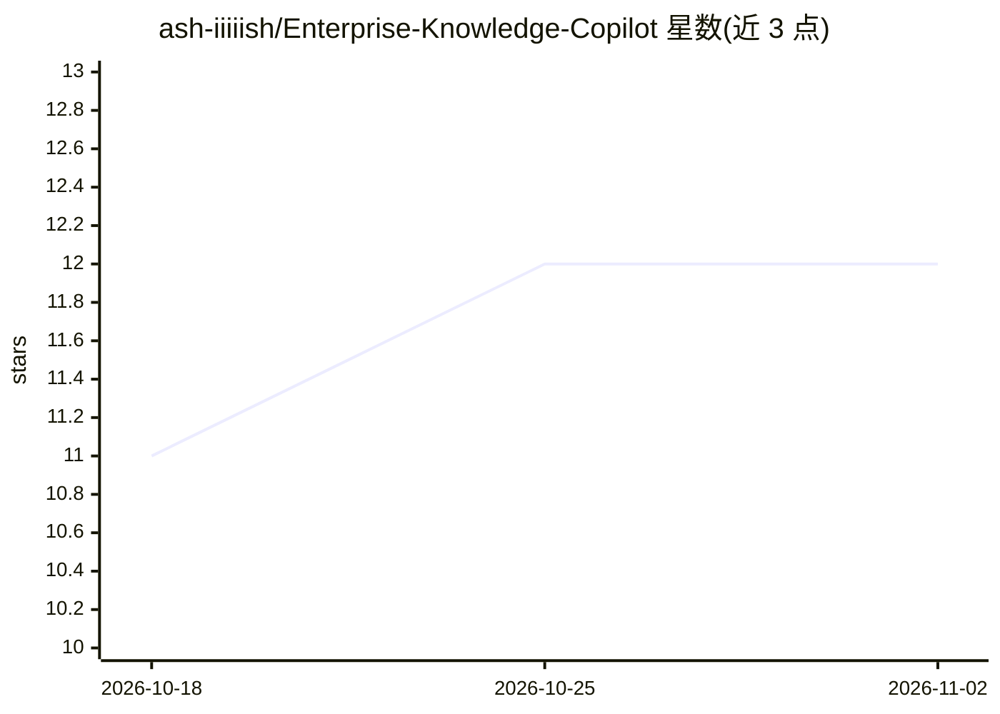

# ash-iiiiish/Enterprise-Knowledge-Copilot

⭐ 12 · Python · Apache-2.0 · 推送 2026-10-30 · [GitHub](https://github.com/ash-iiiiish/Enterprise-Knowledge-Copilot) · 个人维护

**企业知识助手：RAG + MCP 工具 + Self-RAG/CRAG 校验**

基于异步 LangGraph 的企业问答助手：LLM 对每个问题分类路由到直接回答、pgvector 文档检索或 MCP 工具（工单增查、员工查询、公司政策、内部知识库）；检索结果经 CRAG 相关性评分，无相关文档时改写查询并回退 DuckDuckGo 网络搜索；最终答案经 Self-RAG 校验后才输出。提供 FastAPI 后端与 Streamlit 聊天界面（SSE 流式、工具调用可见、线程持久化），支持 PDF 上传入库。需自备 PostgreSQL+pgvector 与 Groq API key，Python 3.12+ 源码运行。

## 筛选速览

| 维度 | 判定 | 备注 |
|---|---|---|
| AI 角色 | `ai-native` | 本体是模型或模型工具 |
| 许可风险 | `permissive` | Apache-2.0 |
| 部署形态 | `library` | 以包/库形式分发 |
| 模型依赖 | locked-api |  |
| 硬件要求 | — | 无带数字的原话,不猜 |
| 安装摩擦 | `low` | 无编译、无系统依赖或容器化 |
| 成熟度 | — | 结构信号不足 |

## 能力要点

- 问题分类路由：直接回答 / pgvector RAG / MCP 工具三路径
- CRAG 检索校验 + 查询改写 + 网络搜索回退
- Self-RAG 对最终答案做上下文核验，未通过则重写重试
- 非 LLM 的词干匹配工具路由，区分工单 CREATE/LIST/QUERY 意图

## 适用场景

- 我把公司制度、入职文档做成可问答的知识库
- 让 AI 助手查工单、查员工信息、检索内部知识并给出有校验的回答
- 需要看到 AI 调用了哪个工具、依据哪些来源的透明问答

## 场景标签

`RAG` `AI 助手` `文档问答` · 领域:对话与助手

## 证据(README 行号)

> L3: An async, LangGraph-powered enterprise assistant that combines **RAG** over
> L10: Question → Classify (LLM) → ┬─ direct_path      → general knowledge answer
> L139: |POST|`/api/v1/chat`|Ask a question; returns the full verified answer, sources, and which tool ran|

## 星数曲线

2026-10-18 11 → 2026-11-02 12（+1）

---
*卡片 v1 · prompt 1.4 · 生成 2026-11-01 · 置信度 high · 依据 README sha `bef5891be02d` · [字段定义](../../DATASET.md)*
