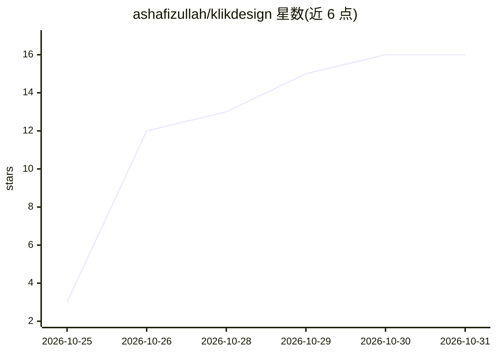

# ashafizullah/klikdesign

⭐ 16 · TypeScript · MIT · 推送 2026-10-28 · [GitHub](https://github.com/ashafizullah/klikdesign) · 个人维护

**桌面海报编辑器：AI 生成排版，画布与对话继续修改**

基于 Tauri 2 + React 19 + Rust 的开源桌面海报编辑器：输入提示词后 AI 选取配色与字体并排版标题、文案、形状与行动按钮；也可关联项目代码库，AI 读取品牌信息（只读沙箱，不读 .env/.git）后代入真实 logo 生成设计。画布编辑器支持拖拽、图层、撤销等操作，通过对话修改且每次请求为单一撤销步骤。自带 API key（存于系统钥匙串），支持 Anthropic 或任意 OpenAI 兼容 API，含本地 MCP 服务器供 Claude Code、Codex 等编码 agent 驱动。提供 macOS/Windows/Linux 安装包。

## 筛选速览

| 维度 | 判定 | 备注 |
|---|---|---|
| AI 角色 | `ai-enhanced` | 去掉 AI 部分产品仍成立 |
| 许可风险 | `permissive` | MIT |
| 部署形态 | `desktop` | 安装包/桌面程序 |
| 模型依赖 | local-ok | 支持本地模型 |
| 硬件要求 | — | 无带数字的原话,不猜 |
| 安装摩擦 | `low` | 无编译、无系统依赖或容器化 |
| 成熟度 | — | 结构信号不足 |

## 能力要点

- 提示词生成海报排版，对话式修改且单请求单撤销步
- 关联代码库只读沙箱分析品牌色/logo 后生成设计
- 本地 MCP 服务器可被 Claude Code、Codex、Cursor 等客户端驱动
- 导出 PNG/JPG（0.5×–3×）、PDF、SVG

## 适用场景

- 用自然语言快速生成产品发布或活动海报
- 从代码库提取品牌元素后自动排版宣传图
- 让编码 agent 通过 MCP 直接编辑设计并导出

## 场景标签

`图像生成` · 领域:内容生成

## 证据(README 行号)

> L24: - **Canvas editor**: drag, resize, rotate, snap guides, multi-select, inline text editing, layers, lock/hide, align
> L28: - **Bring your own model**: Anthropic or any OpenAI-compatible API; keys are stored in the OS keychain

## 星数曲线

2026-10-25 3 → 2026-10-31 16（+13）

---
*卡片 v1 · prompt 1.4 · 生成 2026-10-30 · 置信度 high · 依据 README sha `22eaa9ccda9c` · [字段定义](../../DATASET.md)*
