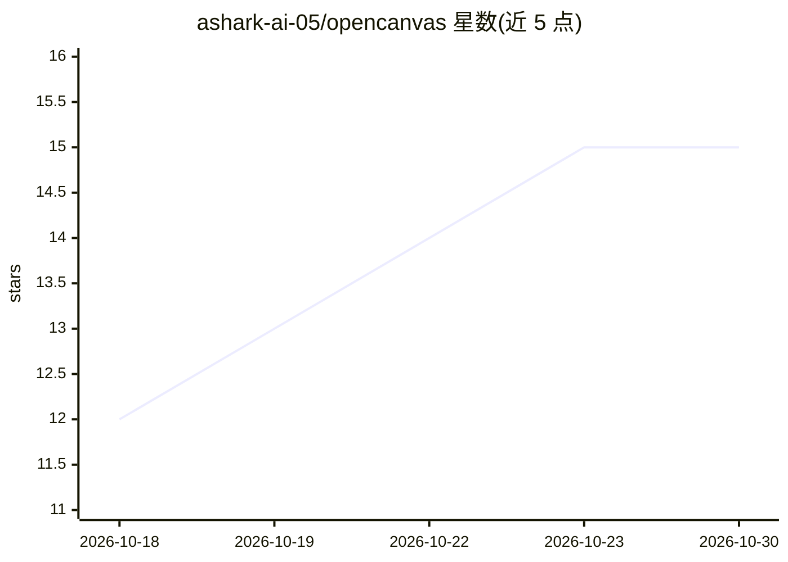

# ashark-ai-05/opencanvas

⭐ 15 · TypeScript · MIT · 推送 2026-10-26 · [GitHub](https://github.com/ashark-ai-05/opencanvas) · [官网](https://opencanvas-production.up.railway.app) · 个人维护

**无限画布 AI 工作台：模型把回答组装成可拖拽的小组件**

本地运行的聊天加无限画布应用：模型不输出文本流，而是调用 place_widget 以带类型的 payload 在画布上生成 15 种组件（图表、看板、表格、计时器、沙箱 HTML 等），可拖拽、固定、导出。支持 Anthropic/OpenAI/Gemini/Groq/OpenRouter 及本地 Ollama，同一工具调用循环；无 API key 时计时器、清单等即时组件仍可用。对话索引进本地 SQLite + sqlite-vec，提供 REST API 与 MCP 接入。以 npx、Docker、桌面安装包或源码方式运行。

## 筛选速览

| 维度 | 判定 | 备注 |
|---|---|---|
| AI 角色 | `ai-native` | 本体是模型或模型工具 |
| 许可风险 | `permissive` | MIT |
| 部署形态 | `self-host` | docker 或自建部署 |
| 模型依赖 | local-ok | 支持本地模型 |
| 硬件要求 | — | 无带数字的原话,不猜 |
| 安装摩擦 | `low` | 无编译、无系统依赖或容器化 |
| 成熟度 | `idea` | |

## 能力要点

- 模型通过 place_widget 工具在画布上生成 15 种类型化组件，可在对话中途注册新组件类型
- 无 API key 时即时识别计时器/清单/换算等输入，不调用模型
- 本地 SQLite + sqlite-vec 记忆索引，⌘K 可跨会话检索组件
- MCP 原生接入，REST API 与 SSE 允许脚本和其他 agent 写入画布

## 适用场景

- 把 AI 回答以图表、看板、表格并排呈现在画布上反复使用
- 用本地 Ollama 完全离线运行画布工作台
- 让脚本或 cron 任务通过 REST API 在画布上放置组件

## 场景标签

`AI 助手` · 领域:对话与助手

## 证据(README 行号)

> L34: The model never prints the answer. It calls `place_widget` with a typed payload, a schema checks it, tldraw draws i
> L58: - **Any model, same agent.** Anthropic, OpenAI, Gemini, Groq, OpenRouter, or Ollama for fully offline. One tool-cal

## 星数曲线

2026-10-18 12 → 2026-10-30 15（+3）

---
*卡片 v1 · prompt 1.4 · 生成 2026-10-30 · 置信度 high · 依据 README sha `70311c16b96e` · [字段定义](../../DATASET.md)*
