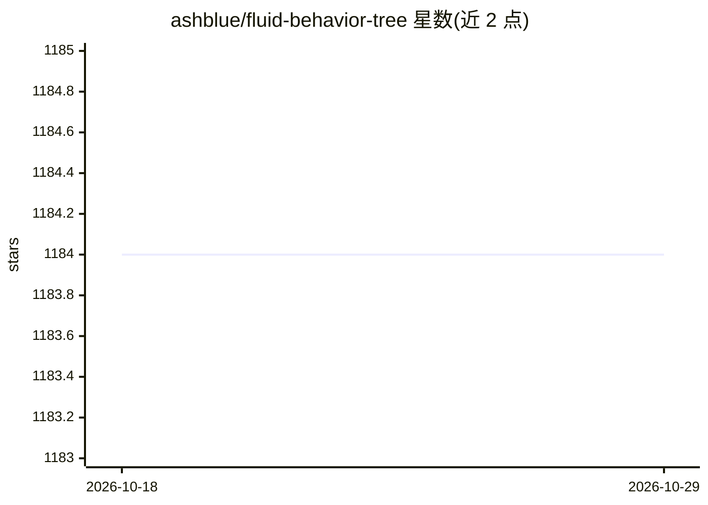

# ashblue/fluid-behavior-tree

⭐ 1,184 · C# · MIT · 推送 2026-05-08 · [GitHub](https://github.com/ashblue/fluid-behavior-tree) · 个人维护

**面向 Unity3D 项目的代码驱动行为树库（builder 模式）**

基于 builder 模式的 C# 行为树库，供 Unity3D 项目以纯代码方式构建游戏 AI 行为逻辑。内置动作、条件、组合节点（Sequence/Selector/Parallel 等）与装饰器节点库，支持自定义节点与树拼接复用，提供运行时树可视化调试，并跨帧跟踪恢复节点执行位置。通过 Unity Package Manager（scoped registry 指向 NPM）安装，附带夺旗示例工程。灵感来自 Fluent Behavior Tree。

## 筛选速览

| 维度 | 判定 | 备注 |
|---|---|---|
| AI 角色 | `ai-ecosystem` | LLM/agent 周边工具 |
| 许可风险 | `permissive` | MIT |
| 部署形态 | `desktop` | 安装包/桌面程序 |
| 模型依赖 | — | README 未给出锁定关系 |
| 硬件要求 | — | 无带数字的原话,不猜 |
| 安装摩擦 | `low` | 无编译、无系统依赖或容器化 |
| 成熟度 | — | 结构信号不足 |

## 能力要点

- builder 模式纯代码构建行为树，支持自定义节点与扩展方法
- 内置 Actions/Conditions/Composites/Decorators 节点库
- 运行时树可视化调试（需 public 或 SerializeField 变量）
- 跨帧跟踪并恢复上一次执行位置（Continue 状态）

## 适用场景

- 为 Unity 游戏 AI 用代码构建可维护的行为树
- 在编辑器运行时可视化调试行为树结构
- 打包可复用节点为 Unity 包在多项目间共享

## 场景标签

 · 领域:游戏开发/Unity

## 证据(README 行号)

> L5: Behavior trees for Unity3D projects. Written with a code driven approach to maximize maintainability on large projec
> L10: * Pre-built library of tasks to kickstart your AI

## 星数曲线

2026-10-18 1,184 → 2026-10-29 1,184（+0）

---
*卡片 v1 · prompt 1.4 · 生成 2026-10-21 · 置信度 mid · 依据 README sha `93b60b069cd0` · [字段定义](../../DATASET.md)*
