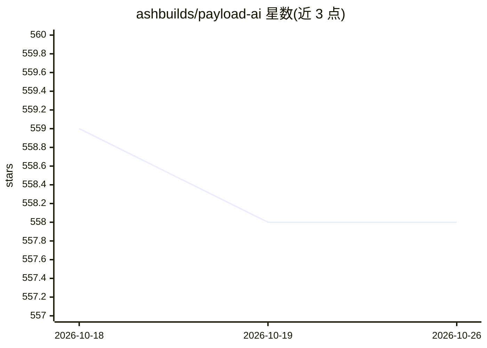

# ashbuilds/payload-ai

⭐ 558 · TypeScript · NOASSERTION · 推送 2026-10-20 · [GitHub](https://github.com/ashbuilds/payload-ai) · 个人维护

**为 Payload CMS 提供 AI 文本/图像/语音能力的插件**

Payload CMS（v3）的第三方插件，在文本与富文本字段上接入 AI 生成：撰写、校对（Beta）、翻译、改写（Beta），上传字段支持 OpenAI（DALL-E/GPT-Image-1）图像生成与 ElevenLabs/OpenAI 语音生成。支持自带模型与字段级提示词，凭证可经环境变量或插件配置注入。引用图片需实现服务端 storage resolver（4.0.0 破坏性变更），并拒绝大于 20 MiB 的文件；处于 Beta 阶段。以 npm 包安装，面向 Payload 开发者。

## 筛选速览

| 维度 | 判定 | 备注 |
|---|---|---|
| AI 角色 | `ai-enhanced` | 去掉 AI 部分产品仍成立 |
| 许可风险 | `none` | NOASSERTION |
| 部署形态 | `library` | 以包/库形式分发 |
| 模型依赖 | locked-api |  |
| 硬件要求 | — | 无带数字的原话,不猜 |
| 安装摩擦 | `low` | 无编译、无系统依赖或容器化 |
| 成熟度 | `idea` | |

## 能力要点

- 文本字段提供 Compose/Proofread/Translate/Rephrase 等 AI 操作
- 上传字段支持 OpenAI 图像生成与 ElevenLabs/OpenAI 语音生成
- 支持自带模型、字段级提示词与访问控制（多租户）
- API 凭证支持环境变量或插件配置两种注入方式

## 适用场景

- 在 Payload CMS 编辑器内直接生成、翻译或润色内容
- 上传字段中生成配图或语音素材
- 按字段与权限控制不同角色的 AI 功能使用

## 场景标签

`AI 写作` `图像生成` `语音合成` · 领域:内容生成

## 证据(README 行号)

> L13: The Payload AI Plugin is your secret weapon for turbocharged content creation. It seamlessly integrates cutting-edg
> L43: - 🎙️ **Voice Generation** - Powered by ElevenLabs & OpenAI
> L48: - 🔌 **Bring Your Own Model** - Not limited to our defaults

## 星数曲线

2026-10-18 559 → 2026-10-26 558（-1）

---
*卡片 v1 · prompt 1.4 · 生成 2026-10-21 · 置信度 high · 依据 README sha `26e3fc892a15` · [字段定义](../../DATASET.md)*
