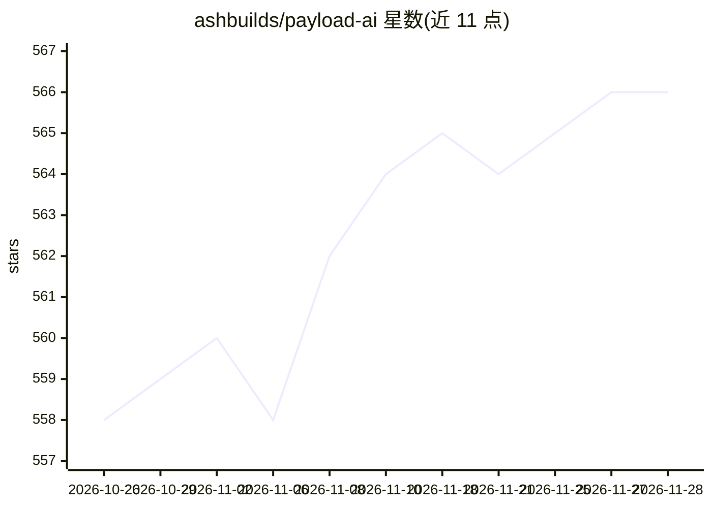

# ashbuilds/payload-ai

⭐ 566 · TypeScript · NOASSERTION · 推送 2026-11-27 · [GitHub](https://github.com/ashbuilds/payload-ai) · 个人维护

**Payload CMS 的 AI 内容生成插件：文本、图像与语音**

面向 Payload CMS 的 TypeScript 插件，在 CMS 内提供 AI 辅助内容工作流：文本字段支持生成、校对、翻译、改写（部分为 Beta），上传字段支持语音合成（ElevenLabs、OpenAI）与图像生成（DALL-E、GPT-Image-1）。机制上支持自定义模型接入、字段级提示词、访问控制、i18n 与自定义 UI 组件。当前为 Beta 状态，测试于 Payload v3.88.0；4.0.0 起参考图像需显式配置存储 resolver，插件自身不抓取外部 URL。

## 筛选速览

| 维度 | 判定 | 备注 |
|---|---|---|
| AI 角色 | `ai-ecosystem` | LLM/agent 周边工具 |
| 许可风险 | `none` | NOASSERTION |
| 部署形态 | `library` | 以包/库形式分发 |
| 模型依赖 | locked-api |  |
| 硬件要求 | — | 无带数字的原话,不猜 |
| 安装摩擦 | `low` | 无编译、无系统依赖或容器化 |
| 成熟度 | `idea` | |

## 能力要点

- 文本字段生成/校对/翻译/改写，字段级提示词自定义
- 语音（ElevenLabs、OpenAI）与图像（DALL-E、GPT-Image-1）生成
- BYOM 自定义模型接入与字段级访问控制
- 参考图像需服务端 resolveReferenceImage resolver，内置 20 MiB 限制与 30 秒超时

## 适用场景

- 在 Payload CMS 后台让编辑人员直接生成和润色文章内容
- 为多语言站点批量翻译字段内容
- 在 CMS 内直接生成配图与语音素材
- 按角色限制谁能使用 AI 功能的多租户内容团队

## 场景标签

`AI 写作` `图像生成` `语音合成` · 领域:内容生成

## 证据(README 行号)

> L13: Payload AI adds AI-assisted content workflows to Payload CMS. Generate and edit text, create images and synthesize 
> L55: - 🔌 **Bring Your Own Model** - Not limited to our defaults

## 星数曲线

2026-10-26 558 → 2026-11-28 566（+8）

---
*卡片 v1 · prompt 1.4 · 生成 2026-11-25 · 置信度 high · 依据 README sha `da10247b104a` · [字段定义](../../DATASET.md)*
