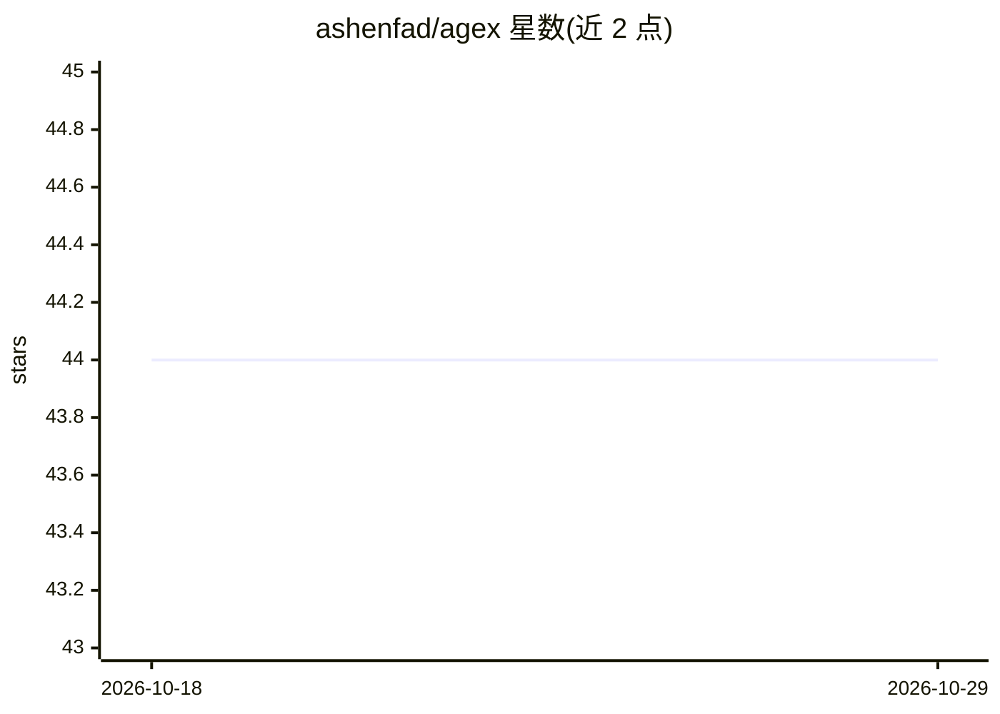

# ashenfad/agex

⭐ 44 · Python · MIT · 推送 2026-10-26 · [GitHub](https://github.com/ashenfad/agex) · 个人维护

**在版本化工作区上运行的 Python agent 框架**

agex 是构建在 nontainer 工作区（文件系统、shell、沙箱 Python）之上的 agent 循环库，提供两种入口：session 按轮驱动工作区，对话存储在工作区分支上，检出提交即回退 agent 记忆；task 是类型化函数，agent 在独立世界中运行并返回声明类型的值，经类型校验后返回结果或 TaskFailed。agent 可与用户库及活对象协作，也能自定义任务做分类、抽取、摘要等判断性工作，并可 map 批量执行。0.13 为新 API，0.12 API 在 v0.12.4 标签与 PyPI 提供。

## 筛选速览

| 维度 | 判定 | 备注 |
|---|---|---|
| AI 角色 | `ai-ecosystem` | LLM/agent 周边工具 |
| 许可风险 | `permissive` | MIT |
| 部署形态 | `library` | 以包/库形式分发 |
| 模型依赖 | — | README 未给出锁定关系 |
| 硬件要求 | — | 无带数字的原话,不猜 |
| 安装摩擦 | `low` | 无编译、无系统依赖或容器化 |
| 成熟度 | — | 结构信号不足 |

## 能力要点

- 会话历史与工作区分支绑定，检出提交即回退 agent 记忆
- 类型化任务：返回值按声明类型校验，得到结果或 TaskFailed
- agent 可调用用户库与活对象（live objects），fork/delegate 一并继承
- agent 可自定义任务并 map 批量运行（分类/抽取/摘要）

## 适用场景

- 构建在沙箱化、可版本回溯环境中运行的编码/数据 agent
- 把判断性工作（分类、抽取、摘要）封装为类型化任务批量执行
- 让 agent 直接操作我的数据库等活对象完成分析脚本

## 场景标签

`Agent 框架` · 领域:Agent 开发

## 证据(README 行号)

> L5: agex is an agent loop over nontainer
> L9: - **A session** drives a workspace turn by turn. Its conversation is

## 星数曲线

2026-10-18 44 → 2026-10-29 44（+0）

---
*卡片 v1 · prompt 1.4 · 生成 2026-10-25 · 置信度 high · 依据 README sha `4288276b0ed5` · [字段定义](../../DATASET.md)*
