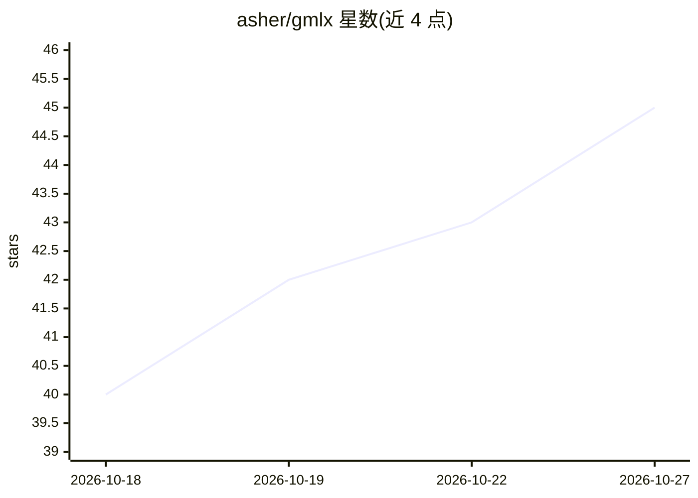

# asher/gmlx

⭐ 45 · Python · NOASSERTION · 推送 2026-10-26 · [GitHub](https://github.com/asher/gmlx) · [官网](https://asher.github.io/gmlx/) · 个人维护

**Apple Silicon 上运行 GGUF 模型的本地推理平台**

面向 Apple Silicon Mac 的本地推理平台：直接加载社区发布的 K-quant/IQ-quant GGUF 文件，基于 MLX 的 Metal 内核运行，支持终端/浏览器对话、OpenAI 与 Anthropic 兼容 API 服务器、编码 agent 接入、语音对话、LoRA 微调与蒸馏，以及图像生成、嵌入、重排和语音转文本。MoE 模型大于内存时可从磁盘流式加载专家。要求 macOS 26.2 或更新，通过 Homebrew/uv/pip 安装；图像生成需 M3 及以上芯片。

## 筛选速览

| 维度 | 判定 | 备注 |
|---|---|---|
| AI 角色 | `ai-ecosystem` | LLM/agent 周边工具 |
| 许可风险 | `none` | NOASSERTION |
| 部署形态 | `library` | 以包/库形式分发 |
| 模型依赖 | — | README 未给出锁定关系 |
| 硬件要求 | — | 无带数字的原话,不猜 |
| 安装摩擦 | `medium` | 含编译或系统依赖之一 |
| 成熟度 | — | 结构信号不足 |

## 能力要点

- 按原样运行社区 K/IQ-quant GGUF 文件（基于 MLX Metal 内核）
- 单一服务器提供 OpenAI Chat/Responses 与 Anthropic Messages 兼容 API
- LoRA 训练与从更大模型蒸馏
- 语音对话、嵌入、重排、语音转文本与图像生成功能

## 适用场景

- 在 Mac 上本地部署 GGUF 模型并通过 API 服务调用
- 为编码 agent 提供本地推理后端
- 对量化模型做 LoRA 微调
- 搭建包含嵌入与语音的本地 RAG 栈

## 场景标签

`推理引擎` `微调` `语音 Agent` `图像生成` · 领域:对话与助手

## 证据(README 行号)

> L11: gmlx is a local inference platform. Chat with an open model in the terminal
> L12: or your browser, serve it over OpenAI and Anthropic compatible APIs, connect

## 星数曲线

2026-10-18 40 → 2026-10-27 45（+5）

---
*卡片 v1 · prompt 1.4 · 生成 2026-10-25 · 置信度 mid · 依据 README sha `ca28c3e747de` · [字段定义](../../DATASET.md)*
