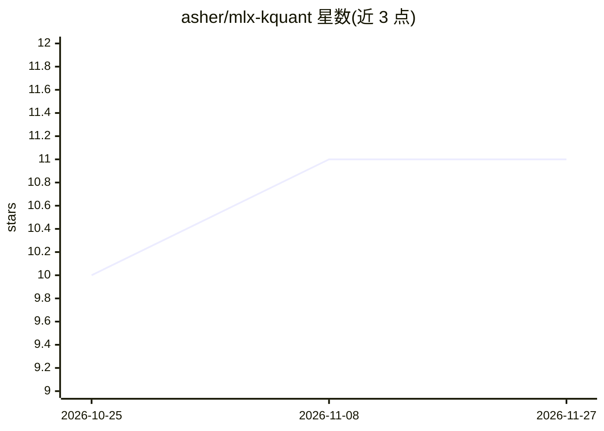

# asher/mlx-kquant

⭐ 11 · C++ · MIT · 推送 2026-11-25 · [GitHub](https://github.com/asher/mlx-kquant) · 个人维护

**为 MLX 增加 K-quant 量化与微调工具链，面向 Apple Silicon**

以 C++/Metal 扩展形式为 MLX 官方 wheel 添加 K-quant 超块与逐块整数编解码的原生算子（kq.* 命名空间），覆盖 23 种量化格式，并提供 quantize/run/chat/lora/fuse 等 CLI 工具，将模型量化为 MLX 原生 safetensors 检查点后加载、生成、LoRA 训练与合并。仅支持 macOS 26.2+ 的 Apple Silicon（Linux 仅 CPU 路径，用于可移植性与 CI），并与 mlx==0.32.3 精确 ABI 绑定。

## 筛选速览

| 维度 | 判定 | 备注 |
|---|---|---|
| AI 角色 | `ai-ecosystem` | LLM/agent 周边工具 |
| 许可风险 | `permissive` | MIT |
| 部署形态 | `library` | 以包/库形式分发 |
| 模型依赖 | — | README 未给出锁定关系 |
| 硬件要求 | `cpu-ok` | |
| 安装摩擦 | `medium` | 含编译或系统依赖之一 |
| 成熟度 | — | 结构信号不足 |

## 能力要点

- 23 种量化编解码（K-quant/legacy/IQ/三元/fp4 等）的 C++/Metal 原生算子
- quantize/run/chat/lora/fuse 命令行工具链与 MLX 原生检查点格式
- 通过 monkeypatch 使 stock mlx-lm 透明加载 K-quant 检查点
- MoE 聚合 matmul（gather_qmm）与 DeepSeek/GLM 稀疏注意力 kernel

## 适用场景

- 在 Apple Silicon 上将 HF 模型量化为 K-quant 并本地推理
- 对量化后的模型做 LoRA 微调并合并回基座
- 在 mlx-lm 服务或评测流程中直接加载 K-quant 检查点

## 场景标签

`模型量化` `微调` · 领域:训练与推理

## 证据(README 行号)

> L30: - **Tooling** (Python) - `mlx-kquant quantize / run / chat / lora / fuse` (plus `verify`, `inspect`,
> L45: mlx-kquant brings them to the MLX ecosystem with tuned Metal kernels. Quantize an MLX safetensors model
> L49: ## Install

## 星数曲线

2026-10-25 10 → 2026-11-27 11（+1）

---
*卡片 v1 · prompt 1.4 · 生成 2026-11-18 · 置信度 high · 依据 README sha `ebc582c519b1` · [字段定义](../../DATASET.md)*
