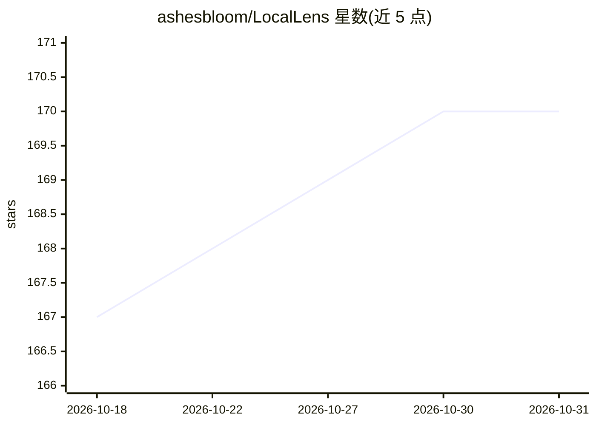

# ashesbloom/LocalLens

⭐ 170 · Python · AGPL-3.0 · 推送 2026-10-12 · [GitHub](https://github.com/ashesbloom/LocalLens) · [官网](Locallens.in) · 个人维护

**离线 AI 照片整理桌面应用：按人脸/地点/日期本地分组**

面向摄影师、家庭用户与大量照片持有者的桌面照片整理工具，基于 Tauri + React 前端与 Python FastAPI 后端。核心机制为两趟人脸检测策略：先用轻量 HOG 扫描，不确定时升级到 CNN，内存不足时自动降级到更轻模型；全部处理在本地运行，无云端上传。支持按人脸训练识别、GPS 聚类可视化、时间线自动排序与快速筛选，文件为非破坏性整理。支持 jpg/png/heic 等常见格式及 RAW 格式；Windows/macOS 提供安装包，Linux 尚未发布。

## 筛选速览

| 维度 | 判定 | 备注 |
|---|---|---|
| AI 角色 | `ai-native` | 本体是模型或模型工具 |
| 许可风险 | `viral` | AGPL-3.0 |
| 部署形态 | `desktop` | 安装包/桌面程序 |
| 模型依赖 | — | README 未给出锁定关系 |
| 硬件要求 | — | 无带数字的原话,不猜 |
| 安装摩擦 | `medium` | 含编译或系统依赖之一 |
| 成熟度 | — | 结构信号不足 |

## 能力要点

- 两趟人脸检测策略（HOG 快扫 + CNN 精扫），内存不足自动降级轻量模型
- 100% 本地离线处理，零数据上传
- 人脸识别训练、GPS 地点聚类、时间线自动排序与非破坏性整理
- 支持 HEIC/HEIF 与 dng/cr2/nef 等多种 RAW 格式

## 适用场景

- 在不上传云端的前提下整理海量照片库
- 训练识别家人朋友的人脸并按人检索照片
- 按拍摄地点和时间线自动归档照片

## 场景标签

`人脸识别` · 领域:感知与多模态

## 证据(README 行号)

> L22:  Local Lens is the AI-powered home for your photos. Sort by face, location, and date entirely offline.
> L92: - **🔒 100% Offline AI**: All facial recognition and analysis runs on your hardware.
> L103: 1. **The Speed Pass (HOG)**: We scan images using a lightweight algorithm (Histogram of Oriented Gradients). If a 

## 星数曲线

2026-10-18 167 → 2026-10-31 170（+3）

---
*卡片 v1 · prompt 1.4 · 生成 2026-10-22 · 置信度 high · 依据 README sha `332895442498` · [字段定义](../../DATASET.md)*
