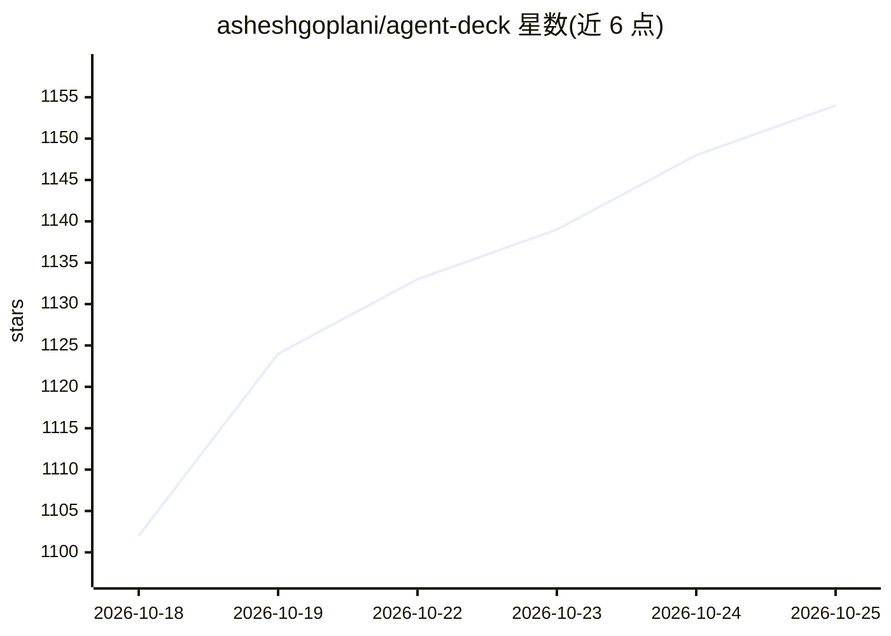

# asheshgoplani/agent-deck

⭐ 1,157 · Go · MIT · 推送 2026-10-25 · [GitHub](https://github.com/asheshgoplani/agent-deck) · [官网](https://discord.gg/e4xSs6NBN8) · 个人维护

**在终端里统一管理多个 AI 编码 agent 会话的 TUI 控制台**

面向同时运行多个 AI 编码 agent（Claude Code、OpenCode、Codex、Gemini 等）的开发者的 Go 语言 TUI 工具：单个终端界面展示所有会话状态，一键切换与附着，支持分组、搜索、会话分叉（继承对话历史）、git worktree、成本看板与 MCP/Skills 管理器。提供 conductor 机制，通过 Telegram/Slack/Discord 等远程通道用手机监督整个 agent 队列。支持 macOS/Linux/Windows(WSL)，经 curl 脚本、Homebrew、go install 或源码安装。

## 筛选速览

| 维度 | 判定 | 备注 |
|---|---|---|
| AI 角色 | `ai-ecosystem` | LLM/agent 周边工具 |
| 许可风险 | `permissive` | MIT |
| 部署形态 | `self-host` | docker 或自建部署 |
| 模型依赖 | — | README 未给出锁定关系 |
| 硬件要求 | — | 无带数字的原话,不猜 |
| 安装摩擦 | `low` | 无编译、无系统依赖或容器化 |
| 成熟度 | — | 结构信号不足 |

## 能力要点

- 单终端集中查看与切换多个 AI agent 会话（运行/等待/完成状态）
- 会话分叉继承父对话历史，支持多级分叉探索不同方案
- MCP Manager 与 Skills Manager 免改配置文件按项目/全局挂载能力
- conductor + Telegram bot 远程监督整个 agent 队列，异常升级到手机

## 适用场景

- 同时在多个项目上跑 Claude Code/OpenCode 等 agent，想在一个界面里全部掌控
- 对同一会话分叉出多个分支尝试不同实现方案
- 离开电脑时通过 Telegram/Slack 查看和控制 agent 运行状态

## 场景标签

 · 领域:开发者工具/AI agent 管理

## 证据(README 行号)

> L17: **Agent Deck is mission control for your AI coding agents.** Running Claude Code on ten projects, OpenCode on five 
> L146: ## Quickstart: orchestrate a fleet of AI agents
> L181: ### MCP Manager

## 星数曲线

2026-10-18 1,102 → 2026-10-25 1,154（+52）

---
*卡片 v1 · prompt 1.4 · 生成 2026-10-21 · 置信度 mid · 依据 README sha `2b31715f9e7d` · [字段定义](../../DATASET.md)*
