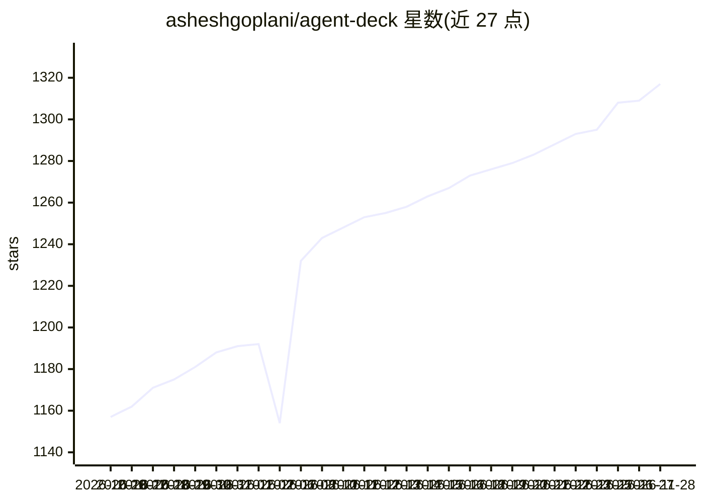

# asheshgoplani/agent-deck

⭐ 1,317 · Go · MIT · 推送 2026-11-23 · [GitHub](https://github.com/asheshgoplani/agent-deck) · [官网](https://discord.gg/e4xSs6NBN8) · 个人维护

**用一张 TUI 统一管理多个 AI 编码 agent 终端会话**

Agent Deck 以终端 TUI 形式运行多个 AI 编码 agent（Claude Code、Codex、Gemini CLI、Antigravity CLI、OpenCode 等），在单一界面集中显示各会话的工作/等待/完成状态，支持会话创建、附加/分离、搜索、分组、MCP 与 skills 管理、成本面板、git worktree、Docker 沙箱与 web UI。提供 shell 脚本与 Homebrew 安装，支持 macOS、Linux 与 Windows (WSL)。面向同时使用多个 AI 编码 agent 的开发者。

## 筛选速览

| 维度 | 判定 | 备注 |
|---|---|---|
| AI 角色 | `ai-ecosystem` | LLM/agent 周边工具 |
| 许可风险 | `permissive` | MIT |
| 部署形态 | `None` |  |
| 模型依赖 | — | README 未给出锁定关系 |
| 硬件要求 | — | 无带数字的原话,不猜 |
| 安装摩擦 | `low` | 无编译、无系统依赖或容器化 |
| 成熟度 | — | 结构信号不足 |

## 能力要点

- 单一 TUI 集中运行并显示多个 AI agent 会话状态（working/waiting/done）
- 支持会话分组、搜索、归档、forking 等会话管理功能
- 提供 MCP 与 skills 管理器、成本面板与用量统计（agent-deck usage）
- 支持 git worktree、Docker 沙箱与远程机器/web UI

## 适用场景

- 同时运行 Claude Code、Codex、Gemini CLI 等多个编码 agent 并统一查看状态
- 在终端中快速创建、附加、切换 agent 会话
- 通过成本面板查看各 agent 的费用与配额使用
- 让本地助手通过只读方式接入并管理 agent-deck 会话

## 场景标签

 · 领域:开发者工具/终端会话管理

## 证据(README 行号)

> L15: Agent Deck runs all your AI coding agents (Claude Code, Codex, Gemini CLI, Antigravity CLI, OpenCode and more) in o
> L39: agent-deck launch . -c claude     # create and start a Claude Code session here

## 星数曲线

2026-10-26 1,157 → 2026-11-28 1,317（+160）

---
*卡片 v1 · prompt 1.4 · 生成 2026-11-23 · 置信度 high · 依据 README sha `0170e46fba0a` · [字段定义](../../DATASET.md)*
