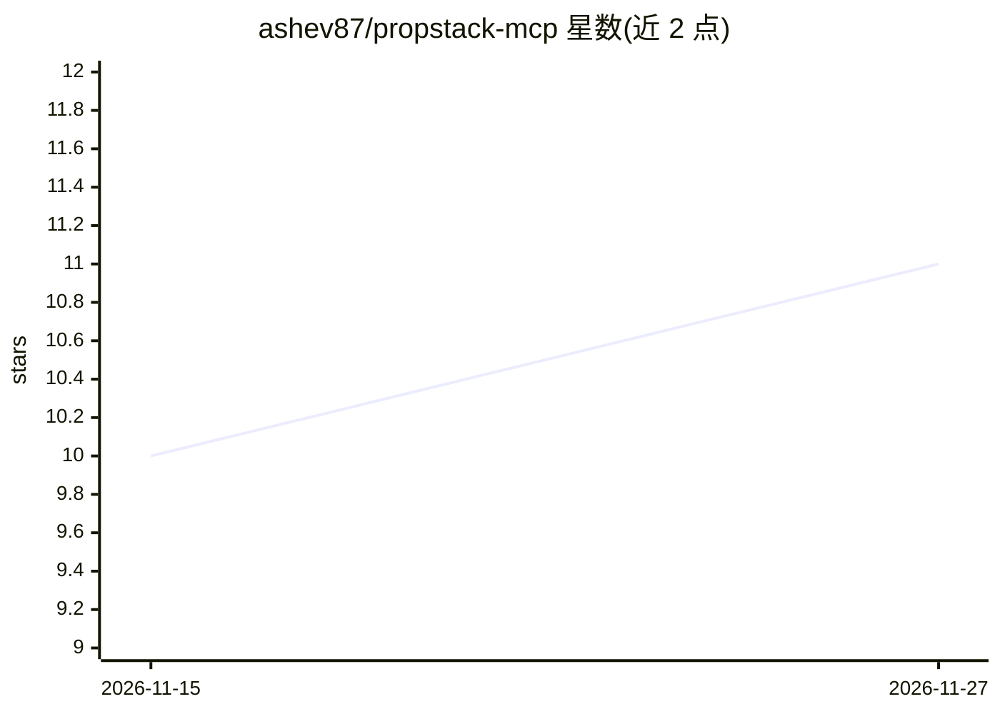

# ashev87/propstack-mcp

⭐ 11 · TypeScript · MIT · 推送 2026-11-16 · [GitHub](https://github.com/ashev87/propstack-mcp) · [官网](https://www.npmjs.com/package/propstack-mcp-server) · 个人维护

**通过 MCP 将 AI 助手接入 Propstack 房产 CRM**

一个 MCP 服务器，把 Claude Desktop、Claude Code、Cursor 等 MCP 客户端连接到 Propstack 房地产 CRM，提供 59 个工具：联系人管理（含 GDPR 状态跟踪）、房源搜索与编辑、交易流水线、自然语言创建买家搜索画像并双向匹配、任务/日历、模板邮件、文档图片上传及 webhook 管理。服务器本地运行、无状态，使用用户自己的 Propstack API key；部分图片操作依赖 Propstack API V2 (beta)。README 含 DSGVO 数据保护说明：CRM 个人数据会被送入所连接的 LLM。

## 筛选速览

| 维度 | 判定 | 备注 |
|---|---|---|
| AI 角色 | `ai-ecosystem` | LLM/agent 周边工具 |
| 许可风险 | `permissive` | MIT |
| 部署形态 | `library` | 以包/库形式分发 |
| 模型依赖 | locked-api |  |
| 硬件要求 | — | 无带数字的原话,不猜 |
| 安装摩擦 | `low` | 无编译、无系统依赖或容器化 |
| 成熟度 | — | 结构信号不足 |

## 能力要点

- 59 个 MCP 工具覆盖联系人、房源、交易、任务、邮件、文档等 CRM 操作
- 自然语言创建搜索画像并与房源双向匹配（match_contacts_to_property 等）
- smart_lead_intake 一体化线索录入：去重、建联系人、记录、建交易、设提醒
- 支持 Claude Desktop/Claude Code/Cursor 本地接入，npx 直接运行

## 适用场景

- 在 Claude Desktop 中用对话管理 Propstack 联系人与房源
- 中介接到客户来电后一句话完成线索录入和跟进提醒
- 每日晨会前让 AI 汇总日历、新线索与滞留交易
- 新房源上架后自动找出匹配的潜在买家

## 场景标签

 · 领域:房地产/CRM 集成

## 证据(README 行号)

> L1: # Propstack MCP Server
> L3: Connect AI assistants (Claude, ChatGPT) to your Propstack real estate CRM.
> L108: ## Available Tools (59)

## 星数曲线

2026-11-15 10 → 2026-11-27 11（+1）

---
*卡片 v1 · prompt 1.4 · 生成 2026-11-20 · 置信度 high · 依据 README sha `e93956884e3b` · [字段定义](../../DATASET.md)*
