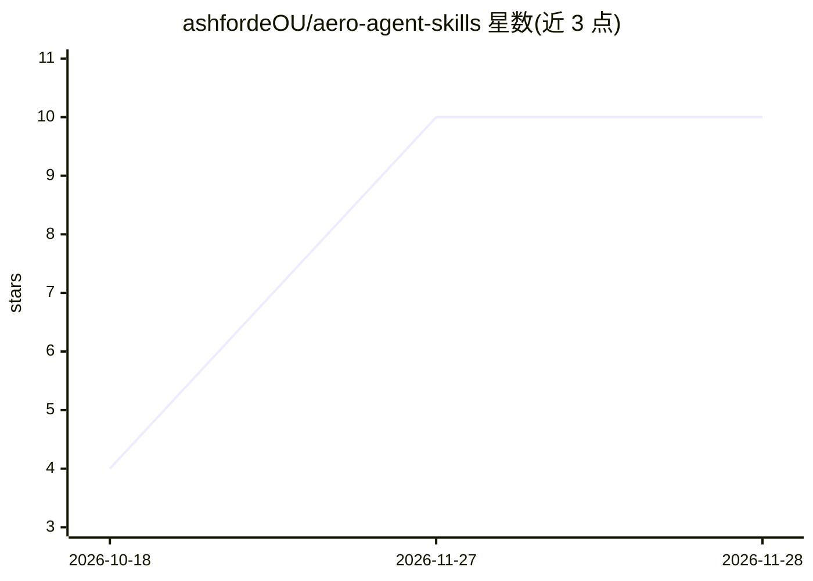

# ashfordeOU/aero-agent-skills

⭐ 10 · Python · Apache-2.0 · 推送 2026-09-26 · [GitHub](https://github.com/ashfordeOU/aero-agent-skills) · [官网](https://ashforde.org/aeroagentskills/) · 组织维护

**为 AI agent 提供航空航天工程认证流程技能库**

以 agentskills.io 开放格式发布的 SKILL.md 技能集合，共 3,200 条技能、86 个可安装包、12 个工程族，映射到 DO-178C、ECSS、ARP4754A 等 30 项标准。每个技能描述标准的使用时机、工作流程、常见陷阱及人工签核停止点。提供 npm CLI、MCP 服务器、JetBrains 插件、Claude Code 插件等多种接入通道，并带 6,330 案例 Hit@1 路由语料与 19 项确定性门禁。面向航天/航空工程师与软件产品保证人员，服务于适航与空间标准合规工作。

## 筛选速览

| 维度 | 判定 | 备注 |
|---|---|---|
| AI 角色 | `ai-knowledge` | 知识聚合/清单类 |
| 许可风险 | `permissive` | Apache-2.0 |
| 部署形态 | `library` | 以包/库形式分发 |
| 模型依赖 | — | README 未给出锁定关系 |
| 硬件要求 | — | 无带数字的原话,不猜 |
| 安装摩擦 | `low` | 无编译、无系统依赖或容器化 |
| 成熟度 | — | 结构信号不足 |

## 能力要点

- 3,200 条技能覆盖 12 个工程族、映射 30 项标准（ECSS/DO-178C/NASA 等）
- npm CLI 提供 list/search/show/install 命令，零依赖单二进制
- MCP 服务器提供确定性 search_skills 路由（Hit@1 语料 6,330 案例）
- 每个技能内含 'stop — human sign-off required' 人工签核门

## 适用场景

- 让 coding agent 逐步走 ECSS-Q-ST-80C 软件产品保证流程
- 生成 DO-178C 验证计划草稿并携带 DAL 分配
- 在 IDE 内检索航空航天标准条款与工作流
- 为供应商管控、配置管理、符合性矩阵等任务调用对应技能

## 场景标签

`编码 Agent` `提示工程` · 领域:Agent 开发

## 证据(README 行号)

> L5:  The aerospace knowledge layer for AI agents.
> L39: **Aero Agent Skills encodes the process** — when to use a standard, the workflow, the pitfalls, and the point where
> L79: |**agentskills.io format**|open spec — any SKILL.md host can load the library (Claude, Codex, Gemini, Cursor, OpenC

## 星数曲线

2026-10-18 4 → 2026-11-28 10（+6）

---
*卡片 v1 · prompt 1.4 · 生成 2026-11-27 · 置信度 high · 依据 README sha `7f5885a1389d` · [字段定义](../../DATASET.md)*
