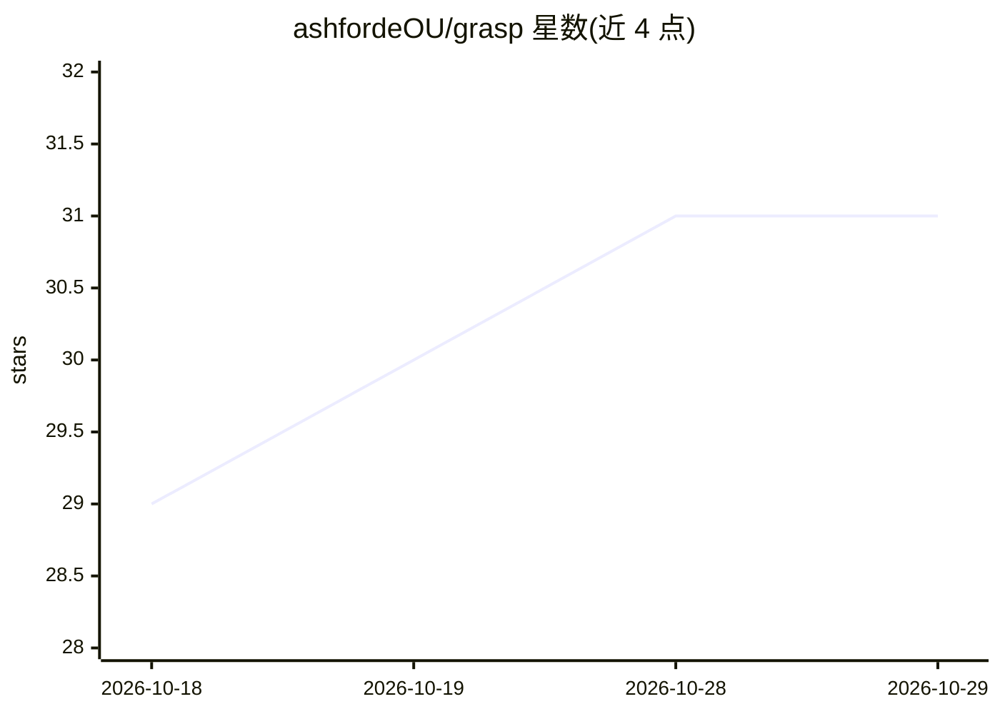

# ashfordeOU/grasp

⭐ 31 · HTML · NOASSERTION · 推送 2026-09-07 · [GitHub](https://github.com/ashfordeOU/grasp) · [官网](https://ashfordeou.github.io/grasp) · 个人维护

**代码架构分析与可视化套件，含 150 工具 MCP 服务器**

面向开发者的代码架构分析套件：将 GitHub/GitLab 仓库或本地代码库解析为依赖图、架构图等 10 种视图，支持 35 种语言（tree-sitter AST）。核心交付形态包括浏览器端两个 HTML 文件（零安装、零数据收集）、npm 分发的 MCP 服务器（150 工具，供 Claude Code、Cursor 等 agent 调用获取仓库上下文）、IDE 扩展与浏览器扩展。附加能力：OSV.dev 等多源漏洞扫描、DORA 指标、SQLite+Kuzu 持久化存储、文档摄入的多模态知识图谱（PDF/OCR/音视频，本地 Whisper）。AI 聊天面板支持 11 个提供商，默认关闭。

## 筛选速览

| 维度 | 判定 | 备注 |
|---|---|---|
| AI 角色 | `ai-ecosystem` | LLM/agent 周边工具 |
| 许可风险 | `none` | NOASSERTION |
| 部署形态 | `desktop` | 安装包/桌面程序 |
| 模型依赖 | local-ok | 支持本地模型 |
| 硬件要求 | — | 无带数字的原话,不猜 |
| 安装摩擦 | `low` | 无编译、无系统依赖或容器化 |
| 成熟度 | — | 结构信号不足 |

## 能力要点

- 150 个 MCP 工具 + 8 Resources + 2 Prompts，供 MCP 兼容 agent 获取仓库上下文
- 浏览器端零安装运行：两个 HTML 文件，代码不离本机
- 35 语言 tree-sitter AST 分析，10 种图视图、11 种导出格式
- 多模态知识图谱：摄入 PDF/DOCX/图像 OCR/音视频并支持带引用的自然语言问答

## 适用场景

- 接手新团队时快速生成代码库架构图与风险热点
- 让 Claude Code/Cursor 等 AI 助手通过 MCP 获取精简仓库上下文
- 扫描依赖 CVE、生成 SBOM/SARIF 做安全审查
- 跨团队仓库健康度与 DORA 指标看板

## 场景标签

`知识图谱` `网络安全` · 领域:知识与检索

## 证据(README 行号)

> L54: **Grasp** turns any GitHub or GitLab repository — cloud or self-hosted — or local codebase into an interactive arch
> L94: |MCP-native — works with Claude Code, Cursor, Copilot, Continue, etc.|✅ 150 tools, 8 Resources, 2 Prompts|
> L183: |**Claude Code**|`claude mcp add grasp -- npx -y grasp-mcp-server`|Native MCP — all 150 tools + 8 Resources + 2 Pr

## 星数曲线

2026-10-18 29 → 2026-10-29 31（+2）

---
*卡片 v1 · prompt 1.4 · 生成 2026-10-26 · 置信度 mid · 依据 README sha `504483a0e92f` · [字段定义](../../DATASET.md)*
