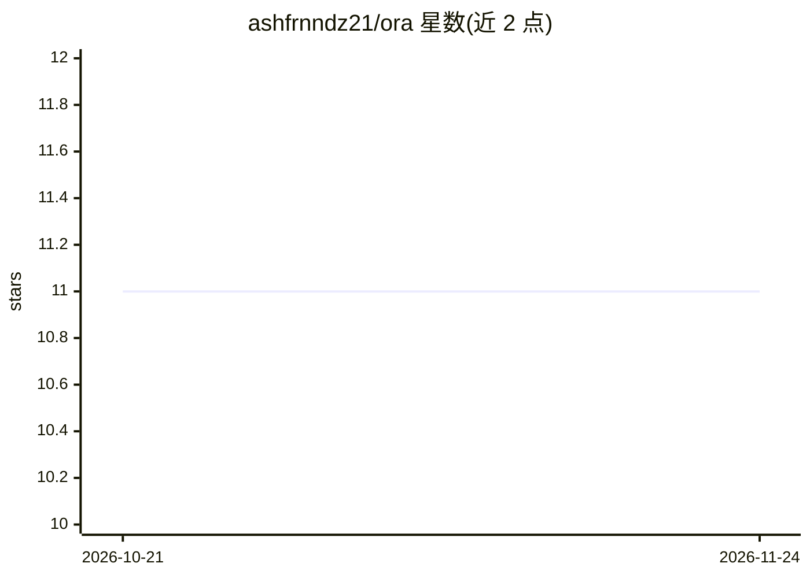

# ashfrnndz21/ora

⭐ 11 · Python · MIT · 推送 2026-06-22 · [GitHub](https://github.com/ashfrnndz21/ora) · [官网](https://ashfrnndz21.github.io/ora/v2.html) · 个人维护

**把自然语言转为 SQL 的 agentic 运行时，支持多数据库多 LLM**

基于 LangGraph 编排的 NL2SQL agent 运行时：将自然语言问题分解、消解实体语义、生成并自我修正 SQL，支持 PostgreSQL、Snowflake、BigQuery、DuckDB 及 Shopify/Salesforce 等 REST 数据源，跨源查询经 DuckDB 内存 JOIN 合并。通过 LiteLLM 接入任意 LLM，可离线用 Ollama 本地模型。内置语义层随查询演化（别名置信度、规则生命周期）、Qdrant 训练对、OpenTelemetry 可观测性与 PolicyGateway 治理（DDL 屏蔽、PII 保护、成本上限）。以 Python 包提供，附 Web 工作台 UI 与 REST API 连接器框架。

## 筛选速览

| 维度 | 判定 | 备注 |
|---|---|---|
| AI 角色 | `ai-native` | 本体是模型或模型工具 |
| 许可风险 | `permissive` | MIT |
| 部署形态 | `library` | 以包/库形式分发 |
| 模型依赖 | local-ok | 支持本地模型 |
| 硬件要求 | — | 无带数字的原话,不猜 |
| 安装摩擦 | `low` | 无编译、无系统依赖或容器化 |
| 成熟度 | — | 结构信号不足 |

## 能力要点

- 3 阶段 ReFoRCE SQL 自我修正与语义一致性校验
- 4 层语义层随每次成功查询演化并持久化
- 跨源分解→并行 agent→DuckDB 内存 JOIN
- PolicyGateway 治理：DDL 屏蔽、PII 保护、成本上限

## 适用场景

- 用自然语言直接查询公司数据库拿结果表
- 跨 Shopify/Salesforce/数据库做多源分析
- 需要可审计、可治理的 NL2SQL 生产部署
- 离线环境用本地模型做数据问答

## 场景标签

`数据分析` · 领域:效率与自动化

## 证据(README 行号)

> L13: An on-machine AI agent that turns natural language into SQL across any database — PostgreSQL, Snowflake, BigQuery, 
> L49: Built on **LangGraph** for orchestration, **OpenTelemetry** for observability, **LiteLLM** for any LLM provider.
> L201: Works with any LLM. Works offline with Ollama. No API key required for local models.

## 星数曲线

2026-10-21 11 → 2026-11-24 11（+0）

---
*卡片 v1 · prompt 1.4 · 生成 2026-11-18 · 置信度 high · 依据 README sha `27a7edc5d6ff` · [字段定义](../../DATASET.md)*
