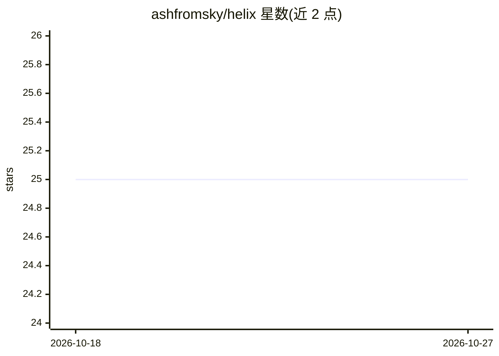

# ashfromsky/helix

⭐ 25 · Python · AGPL-3.0 · 推送 2025-12-19 · [GitHub](https://github.com/ashfromsky/helix) · [官网](https://ashfromsky.github.io/helix-page/#) · 个人维护

**零配置 AI Mock 服务器：按 schema 生成模拟 API 数据**

面向前后端开发者的 API Mock 服务器：无需手写假数据，命中任意端点即返回数据；通过系统提示文件定义 schema 后保证响应结构一致。AI 后端可选 demo 模板（Faker）、DeepSeek（经 OpenRouter）、Groq 或本地 Ollama，由 helix init/config CLI 配置。基于 FastAPI 与 Redis 缓存，提供会话上下文、混沌工程、OpenAPI 规范生成与实时请求监控面板。安装途径为 git clone 源码或 docker-compose。

## 筛选速览

| 维度 | 判定 | 备注 |
|---|---|---|
| AI 角色 | `ai-ecosystem` | LLM/agent 周边工具 |
| 许可风险 | `viral` | AGPL-3.0 |
| 部署形态 | `self-host` | docker 或自建部署 |
| 模型依赖 | local-ok | 支持本地模型 |
| 硬件要求 | — | 无带数字的原话,不猜 |
| 安装摩擦 | `low` | 无编译、无系统依赖或容器化 |
| 成熟度 | — | 结构信号不足 |

## 能力要点

- schema 强制：结构一次定义，响应始终匹配
- 四种 AI 提供方可选，含 Ollama 完全离线模式
- 混沌工程模拟错误率与延迟
- 从流量生成 OpenAPI 规范

## 适用场景

- 后端未就绪时给前端提供符合 schema 的模拟接口
- 测试应用对失败和延迟等异常的处理
- 离线/隐私场景用本地 Ollama 生成 mock 数据

## 场景标签

 · 领域:开发者工具/API Mock

## 证据(README 行号)

> L3: **AI-powered API mocking server with guaranteed schema compliance.**
> L172: - **AI-Powered** - Uses DeepSeek, Groq, Ollama, or built-in templates

## 星数曲线

2026-10-18 25 → 2026-10-27 25（+0）

---
*卡片 v1 · prompt 1.4 · 生成 2026-10-27 · 置信度 mid · 依据 README sha `5c17024bb315` · [字段定义](../../DATASET.md)*
