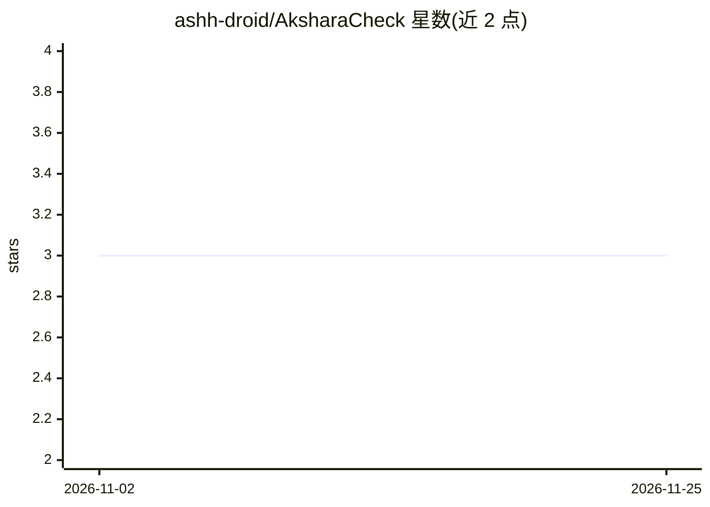

# ashh-droid/AksharaCheck

⭐ 3 · HTML · 推送 2026-10-31 · [GitHub](https://github.com/ashh-droid/AksharaCheck) · [官网](https://ashh-droid.github.io/AksharaCheck/) · 个人维护

**检测印地语/卡纳达语文本渲染缺陷的 Chromium 扫描器**

AksharaCheck 在 Chromium 中以手机（390px）与桌面（1440px）两种宽度扫描网页，用规则检测印地语/卡纳达语的字符断裂、字体未加载、语言标签错误、文本溢出等问题，并记录截图与 Unicode 证据，输出 HTML/Markdown/JSON 报告。可选接入 BharatCode AI（qwen-3.8-27b）为可操作发现生成多语言解释与 CSS/lang 修复建议，修复须通过新的 Chromium 复检才标记为 verified。提供 CLI、FastAPI 本地服务与 React 本地界面；浏览器规则产出发现，模型不做检测，面向印度语言网站的开发者与可访问性检查者。

## 筛选速览

| 维度 | 判定 | 备注 |
|---|---|---|
| AI 角色 | `ai-enhanced` | 去掉 AI 部分产品仍成立 |
| 许可风险 | `none` | — |
| 部署形态 | `desktop` | 安装包/桌面程序 |
| 模型依赖 | — | README 未给出锁定关系 |
| 硬件要求 | — | 无带数字的原话,不猜 |
| 安装摩擦 | `low` | 无编译、无系统依赖或容器化 |
| 成熟度 | — | 结构信号不足 |

## 能力要点

- Chromium 双宽度扫描，规则产出渲染发现并附截图证据
- 可选 BharatCode AI 解释发现并提出白名单范围内的修复
- 修复建议须经新 Chromium 复检通过才标记 verified
- 浏览器检查路径无需 API key 或账户

## 适用场景

- 检查印地语/卡纳达语网站的文字断裂、溢出与字体问题
- 排查语言标签错误导致的辅助技术误读
- 在 CI 中以 --fail-on error 拦截 Fix 级渲染缺陷

## 场景标签

`浏览器自动化` · 领域:效率与自动化

## 证据(README 行号)

> L3: **Find the letters your website breaks.** AksharaCheck checks Hindi and Kannada text in Chromium, records visual and
> L23: A page can look fine during a quick visual review but contain malformed Indic character sequences, clipped marks, p
> L37: 2. **BharatCode explains (optional).** With `--ai`, BharatCode's `qwen-3.8-27b` receives actionable Fix/Check findi

## 星数曲线

2026-11-02 3 → 2026-11-25 3（+0）

---
*卡片 v1 · prompt 1.4 · 生成 2026-11-22 · 置信度 mid · 依据 README sha `b332c17bf459` · [字段定义](../../DATASET.md)*
