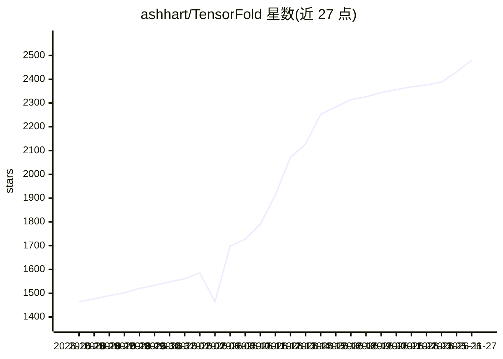

# ashhart/TensorFold

⭐ 2,480 · Zig · Apache-2.0 · 推送 2026-11-26 · [GitHub](https://github.com/ashhart/TensorFold) · [官网](https://tensorfold.dev) · 个人维护

**本地 LLM 推理引擎：Apple Silicon 与 NVIDIA GPU 上跑模型**

以 Zig 单二进制提供语言模型本地推理服务，读取检查点、分词请求并直接运行 Metal 或 CUDA 内核，无需 Python 或 MLX 安装。提供 Homebrew（macOS）与压缩包（Linux，需 glibc≥2.28、NVIDIA R580 驱动）安装方式；服务端暴露 chat/completions、completions、Responses 与 Anthropic Messages API，并带 tensorfold chat 终端聊天命令，支持并行请求、精确解码、上下文压缩等运行选项。

## 筛选速览

| 维度 | 判定 | 备注 |
|---|---|---|
| AI 角色 | `ai-ecosystem` | LLM/agent 周边工具 |
| 许可风险 | `permissive` | Apache-2.0 |
| 部署形态 | `None` |  |
| 模型依赖 | — | README 未给出锁定关系 |
| 硬件要求 | — | 无带数字的原话,不猜 |
| 安装摩擦 | `medium` | 含编译或系统依赖之一 |
| 成熟度 | — | 结构信号不足 |

## 能力要点

- Zig 单二进制推理服务，无需 Python 或 MLX 安装
- Metal 与 CUDA 内核直接运行，支持 Apple Silicon 与 NVIDIA GPU
- API 兼容 chat/completions、Responses 与 Anthropic Messages 端点
- tensorfold chat 单命令启动服务并流式对话

## 适用场景

- 在 Mac 上本地部署小模型并对外提供 OpenAI 风格 API
- 让本地编码代理指向本地推理服务器
- 终端中一条命令与本地模型对话

## 场景标签

`推理引擎` · 领域:训练与推理

## 证据(README 行号)

> L8: TensorFold serves language models from a Zig binary on Apple Silicon and NVIDIA GPUs.
> L9: The engine reads checkpoints, tokenizes requests and runs Metal or CUDA kernels directly.
> L51: The API also serves completions, Responses and Anthropic Messages. `/v1/models` lists the served name.

## 星数曲线

2026-10-25 1,464 → 2026-11-27 2,480（+1,016）

---
*卡片 v1 · prompt 1.4 · 生成 2026-11-27 · 置信度 high · 依据 README sha `ff8d4eab2057` · [字段定义](../../DATASET.md)*
