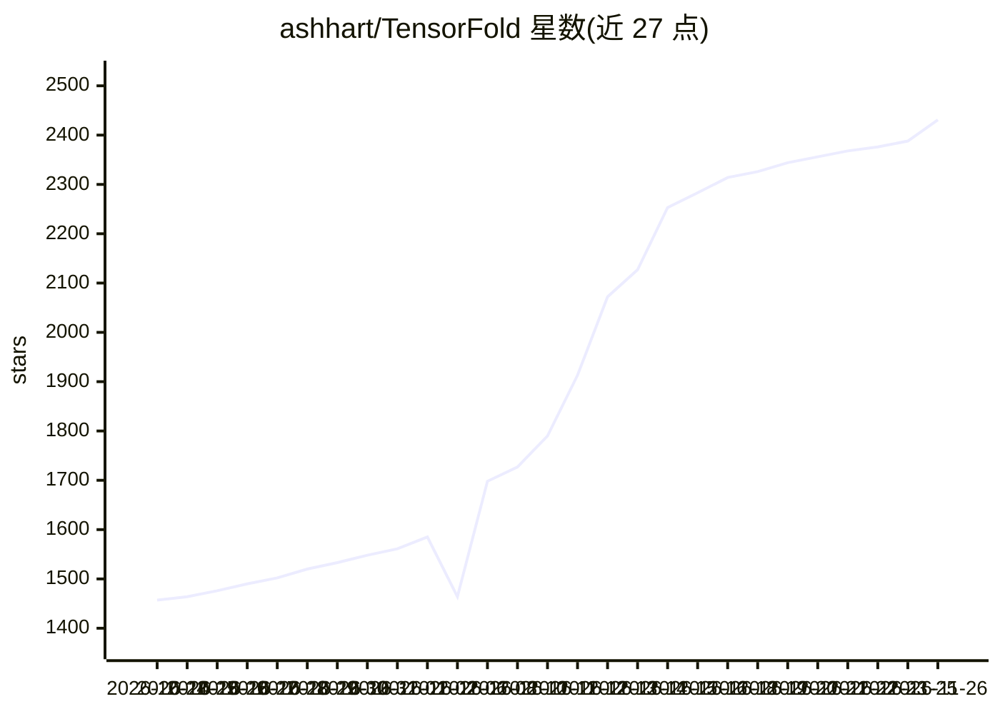

# ashhart/TensorFold

⭐ 2,431 · Zig · Apache-2.0 · 推送 2026-11-25 · [GitHub](https://github.com/ashhart/TensorFold) · [官网](https://tensorfold.dev) · 个人维护

**单二进制 LLM 推理服务，支持 Metal 与 CUDA GPU**

以 Zig 编写的语言模型推理服务引擎，读取模型检查点、对请求分词并直接运行 Metal 或 CUDA 内核，在 Apple Silicon 与 NVIDIA GPU 上提供 OpenAI 兼容的 chat/completions、completions、Responses 与 Anthropic Messages API。服务运行不需要 Python 或 MLX 环境。提供 tensorfold pull 拉取指定版本权重、serve 启动服务、chat 一条命令完成服务启动与流式对话。Linux 需 glibc 2.28+ 与 NVIDIA 驱动 R580+（CUDA 13.0），Windows 有独立指南，采用 Apache-2.0 许可。

## 筛选速览

| 维度 | 判定 | 备注 |
|---|---|---|
| AI 角色 | `ai-ecosystem` | LLM/agent 周边工具 |
| 许可风险 | `permissive` | Apache-2.0 |
| 部署形态 | `None` |  |
| 模型依赖 | — | README 未给出锁定关系 |
| 硬件要求 | — | 无带数字的原话,不猜 |
| 安装摩擦 | `medium` | 含编译或系统依赖之一 |
| 成熟度 | — | 结构信号不足 |

## 能力要点

- Zig 单二进制服务，无需 Python 或 MLX 安装
- 同时暴露 OpenAI 格式与 Anthropic Messages 格式 API
- chat 命令一条命令启动服务并流式对话，支持管道脚本调用
- 实验性 Living Weights：在运行中模型权重内教授新事实

## 适用场景

- 在 Apple Silicon Mac 或 NVIDIA GPU 上本地提供 LLM 推理服务
- 为本地工具或 Claude Code 等客户端提供可缓存前缀的本地 API
- 通过命令行与本地模型快速对话或脚本化调用

## 场景标签

`推理引擎` · 领域:训练与推理

## 证据(README 行号)

> L8: TensorFold serves language models from a Zig binary on Apple Silicon and NVIDIA GPUs.
> L9: The engine reads checkpoints, tokenizes requests and runs Metal or CUDA kernels directly.
> L51: The API also serves completions, Responses and Anthropic Messages. `/v1/models` lists the served name.

## 星数曲线

2026-10-24 1,457 → 2026-11-26 2,431（+974）

---
*卡片 v1 · prompt 1.4 · 生成 2026-11-26 · 置信度 high · 依据 README sha `01077ed48789` · [字段定义](../../DATASET.md)*
