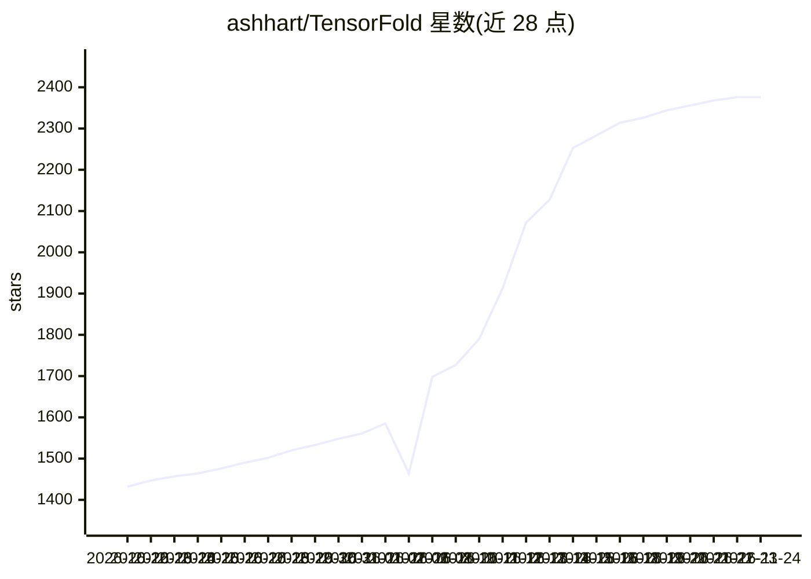

# ashhart/TensorFold

⭐ 2,376 · Zig · Apache-2.0 · 推送 2026-11-22 · [GitHub](https://github.com/ashhart/TensorFold) · [官网](https://tensorfold.dev) · 个人维护

**面向 Apple Silicon 与 NVIDIA GPU 的本地 LLM 推理服务引擎**

TensorFold 以 Zig 二进制形式在 Apple Silicon 和 NVIDIA GPU 上提供语言模型服务：读取模型 checkpoint、对请求分词，并直接运行 Metal 或 CUDA 内核，服务过程无需 Python 或 MLX 环境。提供 OpenAI 兼容的 chat/completions、completions、Responses 及 Anthropic Messages API，附带 tensorfold chat 终端聊天命令。模型权重遵循各自许可证，Linux 需 glibc 2.28+ 与 NVIDIA 驱动 R580+。

## 筛选速览

| 维度 | 判定 | 备注 |
|---|---|---|
| AI 角色 | `ai-ecosystem` | LLM/agent 周边工具 |
| 许可风险 | `permissive` | Apache-2.0 |
| 部署形态 | `None` |  |
| 模型依赖 | — | README 未给出锁定关系 |
| 硬件要求 | — | 无带数字的原话,不猜 |
| 安装摩擦 | `medium` | 含编译或系统依赖之一 |
| 成熟度 | — | 结构信号不足 |

## 能力要点

- Zig 二进制直接运行 Metal/CUDA 内核，无 Python/MLX 依赖
- 同时提供 chat/completions、Responses 与 Anthropic Messages API
- tensorfold chat 命令一键启动服务器并流式聊天
- Living Weights（实验性）：向运行中的模型权重写入新事实

## 适用场景

- 在 Mac Apple Silicon 上本地部署并服务量化 LLM checkpoint
- 在 NVIDIA GPU Linux 机器上运行推理服务器供脚本调用
- 用 curl 或终端命令直接与本地模型对话

## 场景标签

`推理引擎` · 领域:训练与推理

## 证据(README 行号)

> L8: TensorFold serves language models from a Zig binary on Apple Silicon and NVIDIA GPUs.
> L9: The engine reads checkpoints, tokenizes requests and runs Metal or CUDA kernels directly.
> L51: The API also serves completions, Responses and Anthropic Messages. `/v1/models` lists the served name.

## 星数曲线

2026-10-22 1,432 → 2026-11-24 2,376（+944）

---
*卡片 v1 · prompt 1.4 · 生成 2026-11-23 · 置信度 high · 依据 README sha `cf08e2d07bad` · [字段定义](../../DATASET.md)*
