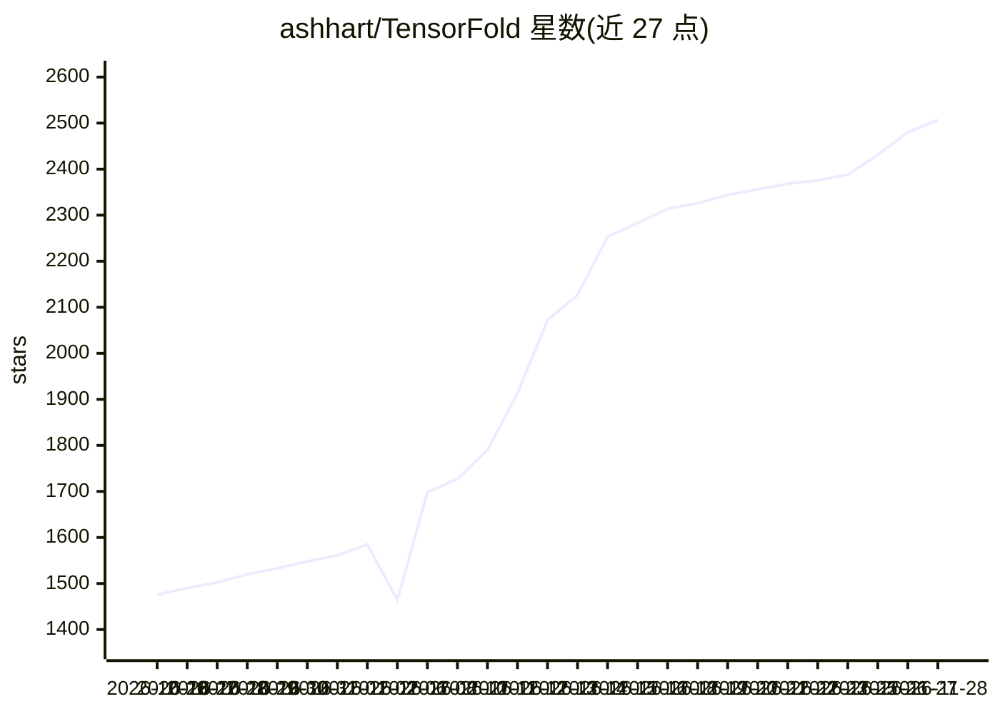

# ashhart/TensorFold

⭐ 2,507 · Zig · Apache-2.0 · 推送 2026-11-27 · [GitHub](https://github.com/ashhart/TensorFold) · [官网](https://tensorfold.dev) · 个人维护

**单二进制本地 LLM 推理服务器，支持 Metal 与 CUDA**

以 Zig 编写的单二进制 LLM 推理服务器，读取模型检查点、对请求分词并在 Apple Silicon（Metal）或 NVIDIA GPU（CUDA）上直接运行内核，无需 Python 或 MLX 环境。提供 OpenAI 兼容的 chat/completions 接口及 Responses、Anthropic Messages 端点，附带 tensorfold chat 终端对话命令和模型下载（pull）功能。macOS 经 Homebrew 安装；Linux 需 glibc 2.28+ 与 NVIDIA 驱动 R580+；Windows 尚未提供 start 命令。以 Apache-2.0 许可发布。

## 筛选速览

| 维度 | 判定 | 备注 |
|---|---|---|
| AI 角色 | `ai-ecosystem` | LLM/agent 周边工具 |
| 许可风险 | `permissive` | Apache-2.0 |
| 部署形态 | `None` |  |
| 模型依赖 | — | README 未给出锁定关系 |
| 硬件要求 | — | 无带数字的原话,不猜 |
| 安装摩擦 | `medium` | 含编译或系统依赖之一 |
| 成熟度 | — | 结构信号不足 |

## 能力要点

- Zig 单二进制，serving 无需 Python 或 MLX 安装
- 支持 Metal 与 CUDA 内核，覆盖 Apple Silicon 与 NVIDIA GPU
- API 同时提供 chat/completions、Responses 与 Anthropic Messages 端点
- tensorfold chat 一条命令启动服务器并流式对话

## 适用场景

- 在 Mac 上本地部署小模型并通过 OpenAI 兼容 API 调用
- 为 Claude Code 等工具提供本地推理服务器
- 脚本中以管道方式获取单条模型回复

## 场景标签

`推理引擎` · 领域:训练与推理

## 证据(README 行号)

> L8: TensorFold serves language models from a Zig binary on Apple Silicon and NVIDIA GPUs.
> L9: The engine reads checkpoints, tokenizes requests and runs Metal or CUDA kernels directly.
> L56: The API also serves completions, Responses and Anthropic Messages. `/v1/models` lists the served name.

## 星数曲线

2026-10-26 1,476 → 2026-11-28 2,507（+1,031）

---
*卡片 v1 · prompt 1.4 · 生成 2026-11-28 · 置信度 high · 依据 README sha `b8ef33ad18d6` · [字段定义](../../DATASET.md)*
