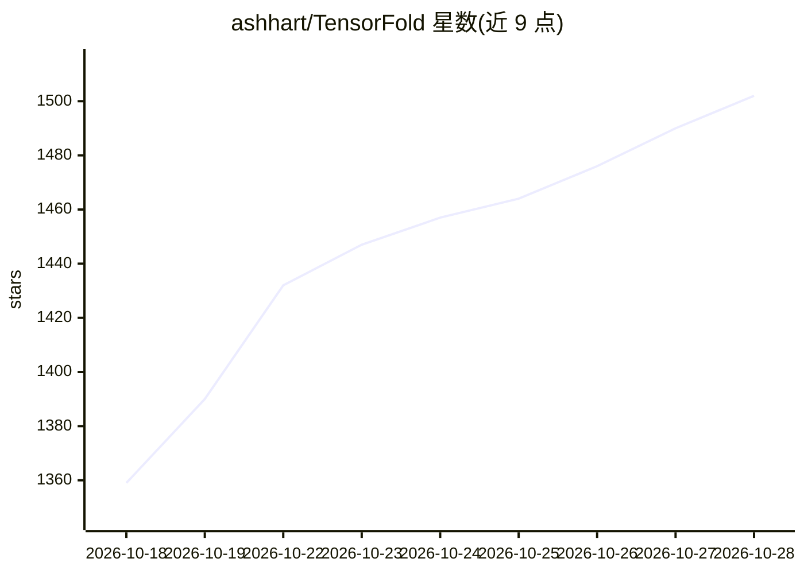

# ashhart/TensorFold

⭐ 1,502 · Zig · Apache-2.0 · 推送 2026-10-27 · [GitHub](https://github.com/ashhart/TensorFold) · [官网](https://tensorfold.dev) · 个人维护

**在 Apple Silicon 与 NVIDIA GPU 上直接运行 LLM 的 Zig 推理引擎**

以单一 Zig 二进制提供语言模型服务：读取检查点、分词请求并直接运行 Metal 或 CUDA 内核，无需安装 Python 或 MLX。通过 `tensorfold pull/serve` 拉取并服务 MLX 4-bit 等格式的检查点（Qwen、Nemotron、GLM、Gemma 等），提供兼容 OpenAI/Anthropic 的本地 HTTP API，并附带 Mac 桌面工作区。实验性 Living Weights 功能可在运行中把新事实写入模型权重文件。限制：DeepSeek 检查点尚不能被任何发布二进制服务，部分模型需两台机器或特定硬件。

## 筛选速览

| 维度 | 判定 | 备注 |
|---|---|---|
| AI 角色 | `ai-ecosystem` | LLM/agent 周边工具 |
| 许可风险 | `permissive` | Apache-2.0 |
| 部署形态 | `None` |  |
| 模型依赖 | — | README 未给出锁定关系 |
| 硬件要求 | — | 无带数字的原话,不猜 |
| 安装摩擦 | `medium` | 含编译或系统依赖之一 |
| 成熟度 | `idea` | |

## 能力要点

- 单一 Zig 二进制直接运行 Metal/CUDA 内核，无需 Python 或 MLX
- 提供 OpenAI 风格 completions/Responses 及 Anthropic Messages API
- 实验性 Living Weights：向运行中的模型权重写入新事实，支持回滚
- 附带 Apple-silicon Mac 桌面工作区（引擎、模型下载、生成指标）

## 适用场景

- 在 Mac 或 NVIDIA GPU 上本地部署 LLM 并以 OpenAI 兼容 API 调用
- 通过 Homebrew 或发布归档快速安装并服务 MLX 4-bit 检查点
- 在实验环境中向模型权重写入事实并观察与回滚

## 场景标签

`推理引擎` · 领域:训练与推理

## 证据(README 行号)

> L3: TensorFold serves language models from a Zig binary on Apple Silicon and NVIDIA GPUs.
> L4: The engine reads checkpoints, tokenizes requests and runs Metal or CUDA kernels directly.

## 星数曲线

2026-10-18 1,359 → 2026-10-28 1,502（+143）

---
*卡片 v1 · prompt 1.4 · 生成 2026-10-21 · 置信度 high · 依据 README sha `591f3741fee5` · [字段定义](../../DATASET.md)*
