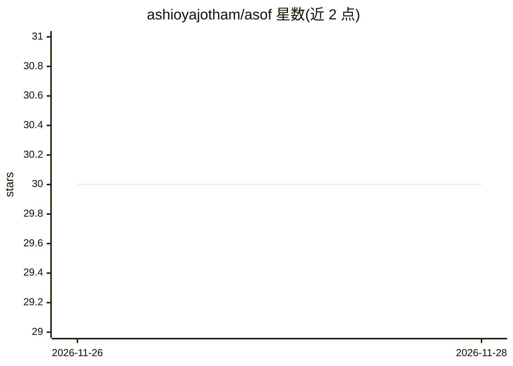

# ashioyajotham/asof

⭐ 30 · Python · Apache-2.0 · 推送 2026-11-25 · [GitHub](https://github.com/ashioyajotham/asof) · 个人维护

**量化金融的 point-in-time 研究平台：杜绝未来函数、保留引用**

面向量化金融研究的 CLI 工具（PyPI: asof-research），按信息实际可得时间重放行情与发行人文件，保留逐字来源引用，并以 Decimal 精确记账模拟模拟组合。核心以 Python 标准库实现，确定性规则优先，仅在文件候选缺失关键字段时调用 hosted Gemini 或本地 GGUF 模型作为后备。支持截面因子研究、跨货币与融券研究、PDF 全文提取、本地 Web 工作台；paper 是唯一执行模式，不接入真实券商。

## 筛选速览

| 维度 | 判定 | 备注 |
|---|---|---|
| AI 角色 | `ai-enhanced` | 去掉 AI 部分产品仍成立 |
| 许可风险 | `permissive` | Apache-2.0 |
| 部署形态 | `library` | 以包/库形式分发 |
| 模型依赖 | local-ok | 支持本地模型 |
| 硬件要求 | — | 无带数字的原话,不猜 |
| 安装摩擦 | `low` | 无编译、无系统依赖或容器化 |
| 成熟度 | — | 结构信号不足 |

## 能力要点

- point-in-time 重放：防止未来信息泄露，逐字来源引用
- 确定性规则优先，LLM（Gemini/GGUF）仅作缺字段后备
- 模拟组合含费用、滑点、股息、融券与跨货币换汇
- 截面因子评估（Rank-IC、IC-IR、分位价差）与本地 Web 工作台

## 适用场景

- 研究股息/公司公告等披露事件对股价的可预期影响
- 无未来函数地回测长仓与融券策略并比较因子有效性
- 从发行人 PDF 提取带引用的股息事件并入本地目录
- 用冻结的 GGUF 模型评估 LLM 提取相对确定性解析器的增益

## 场景标签

`金融量化` · 领域:学习与行业

## 证据(README 行号)

> L11: > **Point-in-time market intelligence, cited filings, and paper research — zero look-ahead, zero broker.**
> L24: Research ingestion, point-in-time storage, and paper simulation are strictly separated from live broker execution. 
> L108: Supply a hosted Gemini project (`--vertex-project`) or a locally merged GGUF (`--gguf`, install `.[model]`) for op

## 星数曲线

2026-11-26 30 → 2026-11-28 30（+0）

---
*卡片 v1 · prompt 1.4 · 生成 2026-11-26 · 置信度 high · 依据 README sha `fb51592f4e45` · [字段定义](../../DATASET.md)*
