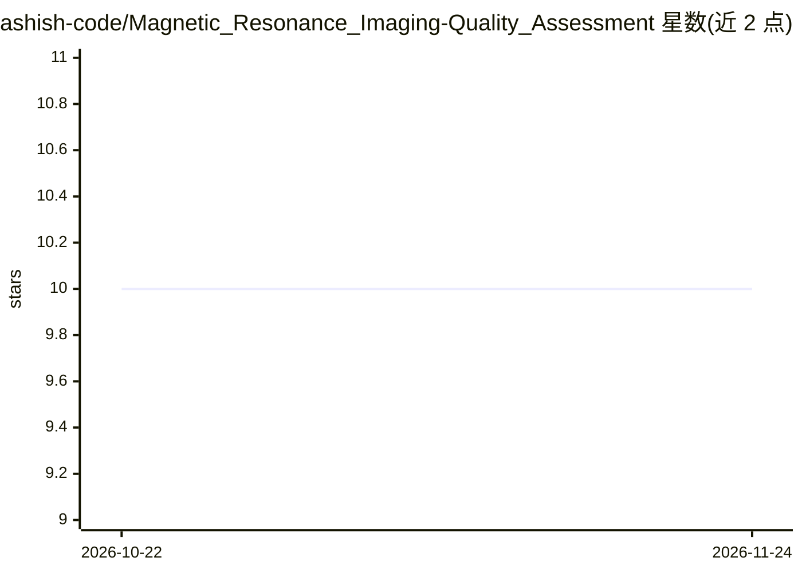

# ashish-code/Magnetic_Resonance_Imaging-Quality_Assessment

⭐ 10 · Python · MIT · 推送 2026-07-28 · [GitHub](https://github.com/ashish-code/Magnetic_Resonance_Imaging-Quality_Assessment) · [官网](https://www.linkedin.com/in/ashishagupta) · 个人维护

**面向神经影像研究者的无参考 MRI 质量自动评估模型**

基于 3D CNN + 全连接网络的结构性 MRI 无参考质量评估管线：输入 3D NIfTI 体数据，经 N4 偏置校正、强度归一化与 1mm 重采样预处理，输出 PASS/FAIL 二值质量标签。在 ABIDE-1 的 15 个采集站点上训练、2 个站点留出测试，并提供到 TCIA 胶质母细胞瘤 MRI 的零样本迁移结果。安装方式为 git clone 源码加 pip 依赖，训练与推理均以 Python 代码示例给出，数据需自行下载 ABIDE-1 预处理数据集并组织目录。

## 筛选速览

| 维度 | 判定 | 备注 |
|---|---|---|
| AI 角色 | `ai-native` | 本体是模型或模型工具 |
| 许可风险 | `permissive` | MIT |
| 部署形态 | `library` | 以包/库形式分发 |
| 模型依赖 | — | README 未给出锁定关系 |
| 硬件要求 | — | 无带数字的原话,不猜 |
| 安装摩擦 | `low` | 无编译、无系统依赖或容器化 |
| 成熟度 | — | 结构信号不足 |

## 能力要点

- 无参考（no-reference）评估，无需干净参照扫描
- 处理完整 3D 体数据以捕捉跨层伪影模式
- ABIDE-1 多站点训练与留出站点泛化测试
- 提供到 TCIA 胶质母细胞瘤数据的零样本迁移结果

## 适用场景

- 大规模多站点 MRI 研究中批量筛查伪影扫描
- 神经影像预处理流水线中自动剔除低质量 T1w 数据
- 在未见采集站点或不同疾病数据上评估模型迁移效果

## 场景标签

`科研工具` · 领域:学习与行业

## 证据(README 行号)

> L13: **Automated, blind (no-reference) quality assessment of structural MRI using a 3D CNN + fully connected deep learni
> L27: This project introduces a **3D CNN-based Blind Image Quality Assessment (BIQA)** system for MRI that:
> L48: |**Output**|Binary: `PASS` / `FAIL` quality label|

## 星数曲线

2026-10-22 10 → 2026-11-24 10（+0）

---
*卡片 v1 · prompt 1.4 · 生成 2026-11-20 · 置信度 high · 依据 README sha `e956537b061b` · [字段定义](../../DATASET.md)*
