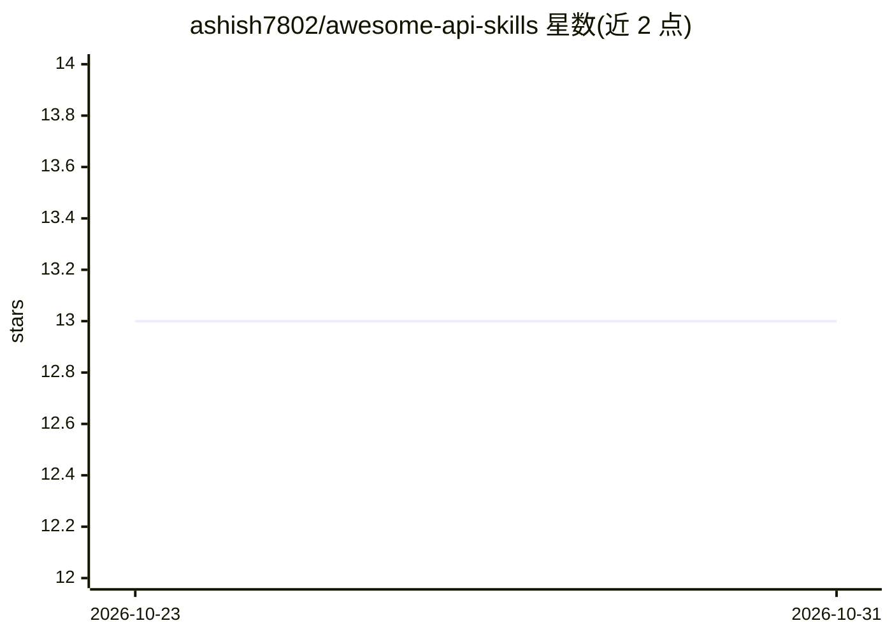

# ashish7802/awesome-api-skills

⭐ 13 · JavaScript · MIT · 推送 2026-10-25 · [GitHub](https://github.com/ashish7802/awesome-api-skills) · [官网](https://awesome-api-skills-6y6z.vercel.app) · 个人维护

**给 AI 编码 agent 用的 API 技能清单（125 个 SKILL.md）**

面向 Claude Code、Cursor、Codex CLI 等 AI 编码 agent 的技能库：提供 125 个经 schema 校验的 SKILL.md 上下文规范，覆盖 AI/LLM、支付、认证、数据库、部署等 15 类技术域，为 agent 注入 API 参数、防幻觉清单与代码模式，避免过期 SDK 用法、签名校验错误等缺陷。将技能目录复制到工作区即可使用，另提供 CLI 搜索校验工具与 React+Vite 交互式浏览应用，仓库含 169 项测试与 273 条知识图谱边的自动验证流程。

## 筛选速览

| 维度 | 判定 | 备注 |
|---|---|---|
| AI 角色 | `ai-knowledge` | 知识聚合/清单类 |
| 许可风险 | `permissive` | MIT |
| 部署形态 | `library` | 以包/库形式分发 |
| 模型依赖 | — | README 未给出锁定关系 |
| 硬件要求 | — | 无带数字的原话,不猜 |
| 安装摩擦 | `low` | 无编译、无系统依赖或容器化 |
| 成熟度 | — | 结构信号不足 |

## 能力要点

- 125 个 schema 校验的 SKILL.md 技能，覆盖 15 个技术域
- 复制到 .claude/skills/ 等目录即可使用，零依赖
- CLI 支持搜索、校验与检视技能
- 自动验证管线：schema 强制、169 项测试、273 条知识图谱边

## 适用场景

- 给 Claude Code/Cursor 等 agent 注入 Stripe、Clerk 等 API 的正确用法
- 避免 AI 生成代码中的过期 SDK 方法与限流问题
- 浏览与检索可用的 API 技能目录

## 场景标签

`提示工程` `精选清单` · 领域:Agent 开发

## 证据(README 行号)

> L5: ### Production-ready, schema-validated `SKILL.md` context specifications that teach AI coding agents how to work wit
> L27: `awesome-api-skills` resolves this by providing **125 curated, schema-validated `SKILL.md` context files**. Droppin
> L71: Our catalog covers **125 verified skills** across 15 core technical domains:

## 星数曲线

2026-10-23 13 → 2026-10-31 13（+0）

---
*卡片 v1 · prompt 1.4 · 生成 2026-10-31 · 置信度 high · 依据 README sha `623ce2ef3685` · [字段定义](../../DATASET.md)*
