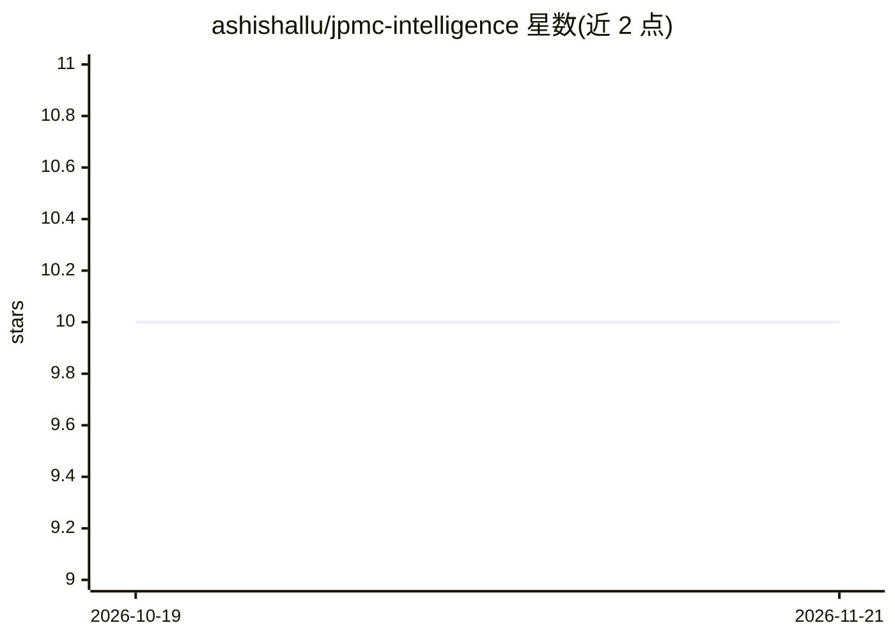

# ashishallu/jpmc-intelligence

⭐ 10 · Python · 推送 2026-07-07 · [GitHub](https://github.com/ashishallu/jpmc-intelligence) · 个人维护

**针对摩根大通文档的 RAG 金融问答助手**

基于 RAG 的问答系统，读取 JPMorgan Chase PDF 文档并生成带来源引用的回答。检索采用稠密（BGE 嵌入）+ 稀疏（BM25）混合方式并以 RRF 融合排序，再经 BGE-Reranker 交叉编码器重排；LLM 经 OpenRouter 接入（默认 Qwen2.5-72B）生成答案。文档按类型自动分类并按类型设定分块策略。提供 Streamlit 聊天界面、文档库浏览、Docker Compose 部署，需自备 OpenRouter API key 与 Hugging Face token。

## 筛选速览

| 维度 | 判定 | 备注 |
|---|---|---|
| AI 角色 | `ai-native` | 本体是模型或模型工具 |
| 许可风险 | `none` | — |
| 部署形态 | `self-host` | docker 或自建部署 |
| 模型依赖 | locked-api |  |
| 硬件要求 | — | 无带数字的原话,不猜 |
| 安装摩擦 | `low` | 无编译、无系统依赖或容器化 |
| 成熟度 | — | 结构信号不足 |

## 能力要点

- 稠密+BM25 混合检索，RRF 融合排序加 BGE-Reranker 重排
- 每个回答附带来源文档引用
- 多轮对话保留上下文，查询指代消解
- Docker Compose 一键部署，按文档类型分块策略

## 适用场景

- 查询摩根大通年报与财报中的营收等数据
- 检索合规政策与代理声明中的关键控制条款
- 按类型和年份浏览与筛选文档分块

## 场景标签

`RAG` `文档问答` · 领域:知识与检索

## 证据(README 行号)

> L1: # 🏦 JPMC Intelligence - RAG-Powered Financial Query Assistant
> L3: A cutting-edge **Retrieval-Augmented Generation (RAG)** system for answering questions about JPMorgan Chase financia
> L61: |LLM|Qwen2.5-72B (OpenRouter)|Answer generation|

## 星数曲线

2026-10-19 10 → 2026-11-21 10（+0）

---
*卡片 v1 · prompt 1.4 · 生成 2026-11-20 · 置信度 high · 依据 README sha `c6bff2ebe202` · [字段定义](../../DATASET.md)*
