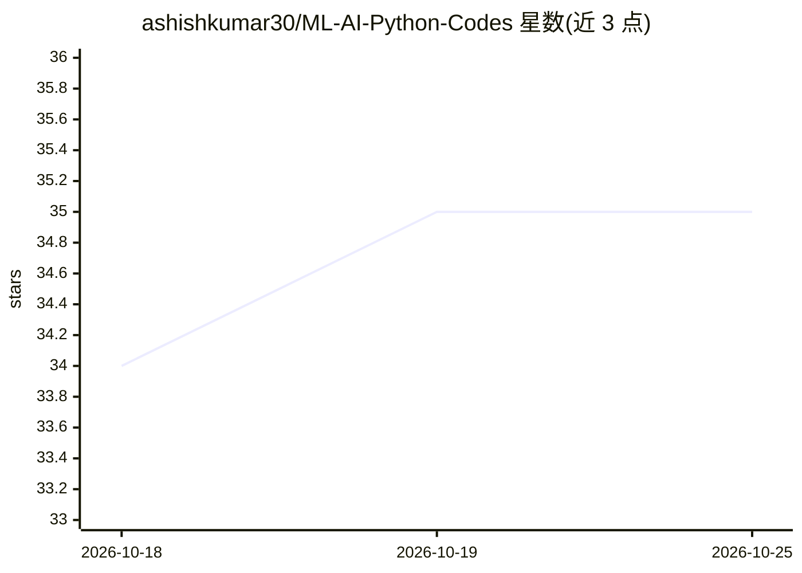

# ashishkumar30/ML-AI-Python-Codes

⭐ 35 · Jupyter Notebook · 推送 2025-10-29 · [GitHub](https://github.com/ashishkumar30/ML-AI-Python-Codes) · 个人维护

**ML/NLP/密码学等 Python 示例代码合集，供学习研究**

个人维护的 Python 代码与 Jupyter Notebook 合集，覆盖机器学习（人脸识别、语音识别、神经网络）、NLP（Spacy/NLTK，含自定义实体识别）、密码学与比特币挖矿概念、图像处理（EasyOCR、OpenCV/PIL）、股票分析（Zerodha API 历史数据下载与实盘交易）、Flask API 与 MySQL/SQLite 数据库集成、排序算法与 Levenshtein 距离等。以 notebook 形式组织，安装方式为 pip 安装依赖后克隆仓库运行，许可声明为开源、供学习研究用途。

## 筛选速览

| 维度 | 判定 | 备注 |
|---|---|---|
| AI 角色 | `ai-knowledge` | 知识聚合/清单类 |
| 许可风险 | `none` | — |
| 部署形态 | `library` | 以包/库形式分发 |
| 模型依赖 | — | README 未给出锁定关系 |
| 硬件要求 | — | 无带数字的原话,不猜 |
| 安装摩擦 | `low` | 无编译、无系统依赖或容器化 |
| 成熟度 | — | 结构信号不足 |

## 能力要点

- 约 20 个 notebook 覆盖 ML/NLP/密码学/图像处理/股票分析/Flask 等领域
- NLP 部分使用 Spacy 与 NLTK，含自定义实体识别
- 含 Zerodha API 的股票历史数据下载与实盘交易示例
- 依赖通过 pip install 一条命令安装

## 适用场景

- 学习 ML、NLP、图像处理的常用 Python 实现
- 参考 Spacy 实体识别、OCR、语音识别的示例代码
- 了解 Zerodha API 股票数据获取与交易流程

## 场景标签

`教程课程` · 领域:学习与行业

## 证据(README 行号)

> L4: This repository contains a collection of Python programs covering various domains such as Machine Learning, Natural 
> L7: - **Machine Learning & AI:** Face recognition, speech recognition, and neural network applications.

## 星数曲线

2026-10-18 34 → 2026-10-25 35（+1）

---
*卡片 v1 · prompt 1.4 · 生成 2026-10-25 · 置信度 high · 依据 README sha `4c753cb520aa` · [字段定义](../../DATASET.md)*
