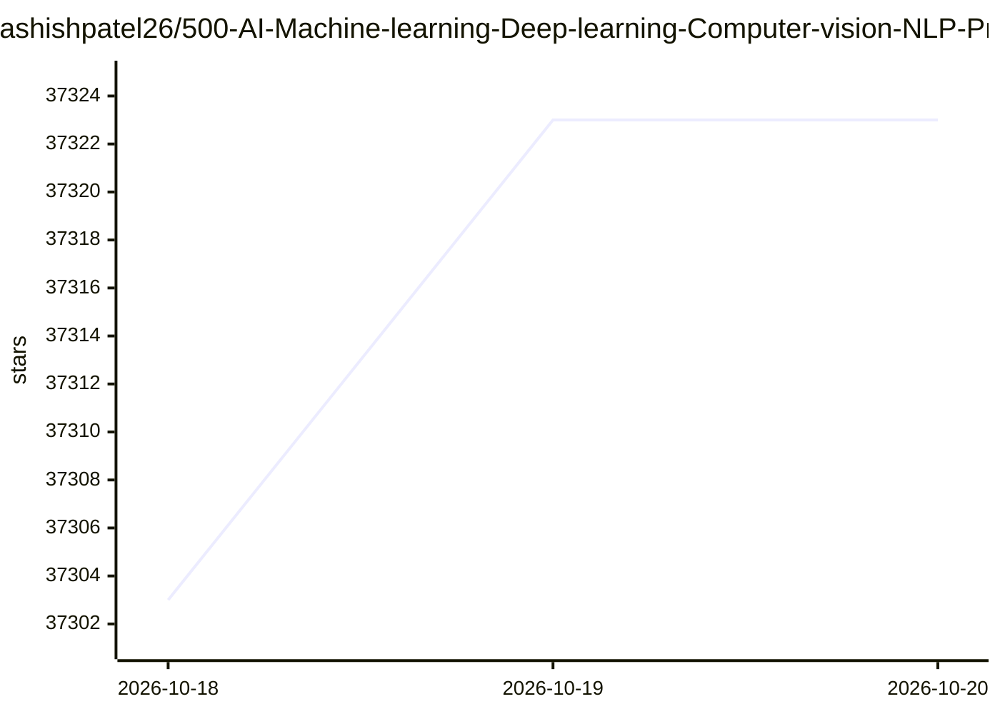

# ashishpatel26/500-AI-Machine-learning-Deep-learning-Computer-vision-NLP-Projects-with-code

⭐ 37,323 · 推送 2026-09-26 · [GitHub](https://github.com/ashishpatel26/500-AI-Machine-learning-Deep-learning-Computer-vision-NLP-Projects-with-code) · 个人维护

**为 AI/ML 学习者提供 500+ 带代码项目的清单**

以 Markdown 表格形式收录的 AI/机器学习/深度学习/计算机视觉/NLP 项目链接清单，条目按序号组织，覆盖时间序列预测、情感分析、聊天机器人、推荐系统、OpenCV、GAN、AutoML、数据集等方向，部分条目为论文与代码合集或学习资源合集。作者声明清单持续更新并接受 pull request 贡献，链接经过测试。README 本身不含安装与运行说明，各项目代码需跳转对应链接获取。

## 筛选速览

| 维度 | 判定 | 备注 |
|---|---|---|
| AI 角色 | `ai-knowledge` | 知识聚合/清单类 |
| 许可风险 | `none` | — |
| 部署形态 | `None` |  |
| 模型依赖 | — | README 未给出锁定关系 |
| 硬件要求 | — | 无带数字的原话,不猜 |
| 安装摩擦 | `low` | 无编译、无系统依赖或容器化 |
| 成熟度 | — | 结构信号不足 |

## 动量与使用信号

- 维护:`active` — 距上次 push 22.3 天,年发版 0,3 位贡献者
- 涨星:近 1 天 **+18**(自 20261016 起算)
- 安装:github 包 `release-assets` 月下载无数据

## 能力要点

- 500+ 条带代码的 AI/ML/DL/CV/NLP 项目链接
- 覆盖 NLP、计算机视觉、时间序列、推荐系统、AutoML 等多方向
- 包含 Kaggle 项目合集与论文带代码合集
- 作者声明持续更新并接受社区贡献

## 适用场景

- 寻找带源码的机器学习练手项目
- 按方向（CV/NLP/深度学习）检索学习资源与项目合集
- 收集数据集与项目灵感

## 场景标签

`精选清单` · 领域:学习与行业

## 证据(README 行号)

> L1: ## 500 + 𝗔𝗿𝘁𝗶𝗳𝗶𝗰𝗶𝗮𝗹 𝗜𝗻𝘁𝗲𝗹𝗹𝗶𝗴𝗲𝗻𝗰𝗲 𝗣𝗿𝗼𝗷𝗲𝗰𝘁 𝗟𝗶𝘀𝘁 𝘄𝗶𝘁𝗵 𝗰𝗼𝗱𝗲
> L7: ***This list is continuously updated.*** - You can take pull requests and contribute. All Links are tested and worki
> L9: |Sr No|Name|Link|

## 星数曲线

2026-10-18 37,303 → 2026-10-20 37,323（+20）

---
*卡片 v1 · prompt 1.4 · 生成 2026-10-18 · 置信度 high · 依据 README sha `479f382cfac6` · [字段定义](../../DATASET.md)*
