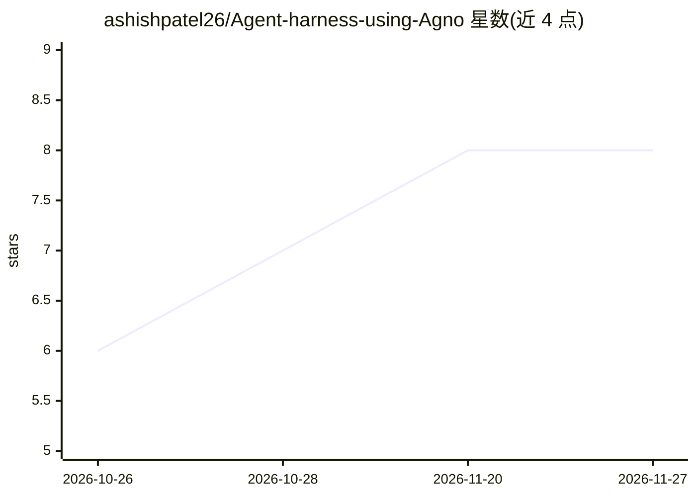

# ashishpatel26/Agent-harness-using-Agno

⭐ 8 · Python · 推送 2026-11-19 · [GitHub](https://github.com/ashishpatel26/Agent-harness-using-Agno) · 个人维护

**用 Agno+本地 Ollama 分层教学构建 agent 工程能力的示例集**

17 个递进式 Python 脚本，逐层演示 agent harness 能力：工具调用、结构化输入输出、SQLite 存储、用户记忆、状态管理、ChromaDB 混合检索、学习沉淀、guardrails、人工审批、多 agent 团队与工作流、AgentOS API 服务。所有示例使用本地 Ollama 模型（qwen3.5:4b 与 nomic-embed-text 嵌入），无需 API key。含知识图谱（Graphiti+FalkorDB）与 E2B 沙箱示例，及整合全部能力的税务合规 A2A 毕业项目。需 uv、Ollama 与 Python 3.14。

## 筛选速览

| 维度 | 判定 | 备注 |
|---|---|---|
| AI 角色 | `ai-ecosystem` | LLM/agent 周边工具 |
| 许可风险 | `none` | — |
| 部署形态 | `None` |  |
| 模型依赖 | local-ok | 支持本地模型 |
| 硬件要求 | — | 无带数字的原话,不猜 |
| 安装摩擦 | `low` | 无编译、无系统依赖或容器化 |
| 成熟度 | — | 结构信号不足 |

## 能力要点

- 17 个脚本按 harness 能力逐层递进，从工具调用到多 agent 工作流
- 全部示例运行在本地 Ollama 模型上，无需 API key
- 含 Graphiti+FalkorDB 的全本地时序知识图谱示例
- 毕业项目将 14 课整合为经 A2A 与 MCP 服务的税务合规多 agent 网络

## 适用场景

- 按课程顺序学习 Agno 框架的 agent 构建方法
- 在本地环境离线实验 agent 记忆、存储与状态管理
- 参考 guardrails、人工审批与多 agent 编排的实现写法
- 搭建全本地知识图谱问答流程

## 场景标签

`教程课程` `Agent 记忆` `多智能体` `RAG` · 领域:Agent 开发

## 证据(README 行号)

> L9:  A step-by-step tour of building AI agents with Agno.
> L14: A model on its own only predicts text. The **harness** is everything around it that turns it into an agent: tools, 
> L91: **1. Requirements:** uv, Ollama, and Python 3.14 (uv installs it for you).

## 星数曲线

2026-10-26 6 → 2026-11-27 8（+2）

---
*卡片 v1 · prompt 1.4 · 生成 2026-11-20 · 置信度 high · 依据 README sha `b3cbf14ec24b` · [字段定义](../../DATASET.md)*
