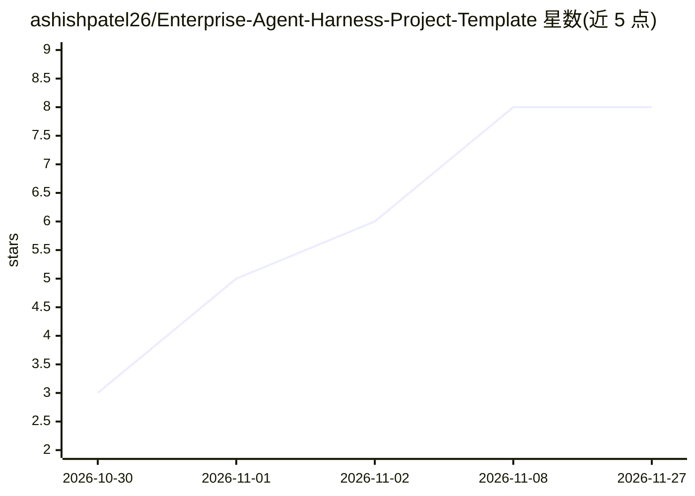

# ashishpatel26/Enterprise-Agent-Harness-Project-Template

⭐ 8 · Python · MIT · 推送 2026-11-13 · [GitHub](https://github.com/ashishpatel26/Enterprise-Agent-Harness-Project-Template) · 个人维护

**企业级 AI Agent harness 项目模板：围绕模型补齐执行、安全与可观测**

以 GitHub 模板形式提供构建 AI Agent 的完整 harness 工程：ReAct 循环、工具注册与沙箱执行（Docker/Kubernetes 可选 gVisor）、YAML 策略引擎与人工审批、Redis/pgvector 记忆、多 agent 编排、OpenTelemetry 遥测与 CI 评估基线门禁。LLM 层提供统一 Provider 接口，含 Anthropic/OpenAI 适配器与 FakeLLM 测试替身；可经 FastMCP 将 agent 暴露给 MCP 客户端。演示无需 API key（脚本化轨迹），真实模型需配置密钥。

## 筛选速览

| 维度 | 判定 | 备注 |
|---|---|---|
| AI 角色 | `ai-ecosystem` | LLM/agent 周边工具 |
| 许可风险 | `permissive` | MIT |
| 部署形态 | `self-host` | docker 或自建部署 |
| 模型依赖 | locked-api |  |
| 硬件要求 | — | 无带数字的原话,不猜 |
| 安装摩擦 | `low` | 无编译、无系统依赖或容器化 |
| 成熟度 | — | 结构信号不足 |

## 能力要点

- ReAct 循环含步数、token/成本预算、超时与停止原因
- Docker 沙箱（无网络、只读 rootfs、非 root）与逃逸测试
- YAML 策略引擎、人工审批（四人选项）、注入筛查与哈希链审计日志
- FastAPI 服务含 SSE 流式续传、审批端点与 MCP 暴露

## 适用场景

- 为团队搭建带审批与审计的内部 agent 平台
- 让危险工具调用在人工批准后再执行
- 在 CI 中用评估基线阻止 agent 行为回归

## 场景标签

`Agent 框架` `多智能体` `LLM 可观测性` `模型评测` · 领域:Agent 开发

## 证据(README 行号)

> L7: **A production-grade, open-source template for building reliable, safe and observable AI agents.**
> L50: This repo gives you all of it, wired together and tested, as a GitHub template. Use it to
> L87: |🦾 **Engines**|`native` (resumable harness loop) or `agno` (Agno loop with ~60 model integrations) per agent, under

## 星数曲线

2026-10-30 3 → 2026-11-27 8（+5）

---
*卡片 v1 · prompt 1.4 · 生成 2026-11-20 · 置信度 high · 依据 README sha `874ecf6ddf4b` · [字段定义](../../DATASET.md)*
