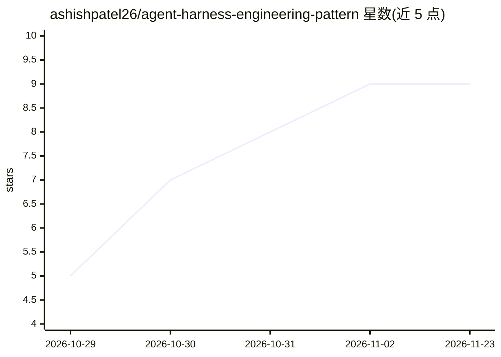

# ashishpatel26/agent-harness-engineering-pattern

⭐ 9 · HTML · 推送 2026-10-27 · [GitHub](https://github.com/ashishpatel26/agent-harness-engineering-pattern) · [官网](https://ashishpatel26.github.io/agent-harness-engineering-pattern/) · 个人维护

**agent 运行框架工程模式知识仓库**

仓库主题标签显示其内容围绕 agent harness 工程模式，涉及上下文管理、记忆系统、编排、技能与工具等子话题。可见的 README 仅包含一行标题与一行重复名称，未提供功能说明、使用对象、安装或运行方式等可验证信息，具体内容需查看仓库内其他文件。

## 筛选速览

| 维度 | 判定 | 备注 |
|---|---|---|
| AI 角色 | `ai-knowledge` | 知识聚合/清单类 |
| 许可风险 | `none` | — |
| 部署形态 | `None` |  |
| 模型依赖 | — | README 未给出锁定关系 |
| 硬件要求 | — | 无带数字的原话,不猜 |
| 安装摩擦 | `low` | 无编译、无系统依赖或容器化 |
| 成熟度 | — | 结构信号不足 |

## 能力要点

- 主题标签覆盖 agent 上下文管理、记忆系统、编排、技能与工具等方向

## 适用场景

- 查找 agent harness 工程模式相关资料

## 场景标签

 · 领域:AI 工程/知识资料

## 证据(README 行号)

> L1: # agent-harness-engineering-pattern

## 星数曲线

2026-10-29 5 → 2026-11-23 9（+4）

---
*卡片 v1 · prompt 1.4 · 生成 2026-11-20 · 置信度 low · 依据 README sha `de8479fdb713` · [字段定义](../../DATASET.md)*
