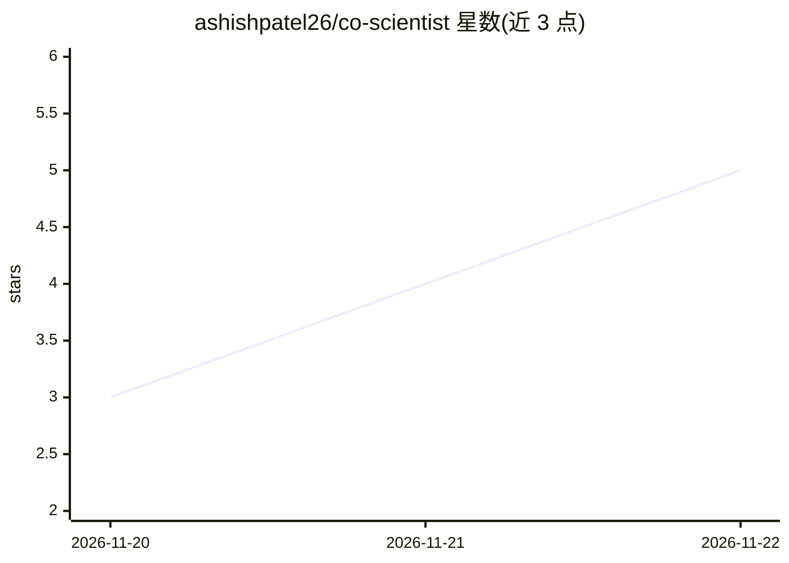

# ashishpatel26/co-scientist

⭐ 5 · Python · 推送 2026-11-19 · [GitHub](https://github.com/ashishpatel26/co-scientist) · 个人维护

**面向研究者：八 agent 协作生成可溯源引用的 arXiv 问答系统**

以 FastAPI 后端 + Next.js 前端构成的多 agent 科研问答应用：Planner 生成检索词，从 arXiv 抓取论文（OpenAlex 兜底），用 nomic-embed-text 与 ChromaDB 排序证据，Synthesis 提出假设，Critic agent 检查并触发至多一轮补充检索，Verifier 以确定性代码剔除虚构引用并要求至少两篇论文支撑。全部模型经 Ollama 本地运行，默认使用 Qwen 3.5 4B 模型；支持 SSE 活动流、证据图谱、立场平衡展示，并提供无 GPU/无网络的确定性 fake 模式。会话保存在内存中，重启即清空。

## 筛选速览

| 维度 | 判定 | 备注 |
|---|---|---|
| AI 角色 | `ai-native` | 本体是模型或模型工具 |
| 许可风险 | `none` | — |
| 部署形态 | `desktop` | 安装包/桌面程序 |
| 模型依赖 | local-ok | 支持本地模型 |
| 硬件要求 | — | 无带数字的原话,不猜 |
| 安装摩擦 | `low` | 无编译、无系统依赖或容器化 |
| 成熟度 | — | 结构信号不足 |

## 能力要点

- 八个 agent 的流水线：检索→排序→阅读→假设→批评→验证
- 确定性引用校验：剔除模型编造的 evidence id，重建引用列表
- 证据按支持/反驳双立场标注并展示平衡
- CS_FAKE_LLM=1 提供无需 GPU 与网络的确定性演示模式

## 适用场景

- 对研究问题获得每条论断可追溯到 arXiv 原文的回答
- 本地环境运行科研问答、问题数据不出本机
- 用小型本地模型（4B）测试多 agent 工作流的可行性

## 场景标签

`多智能体` `RAG` `科研工具` `文档问答` · 领域:Agent 开发

## 证据(README 行号)

> L3: **Ask a research question. Eight AI agents find the papers, read them, argue about them,
> L21: - **Evidence first.** Answers are synthesised only from passages actually retrieved from arXiv,
> L29: - **Private by default.** All models run locally through Ollama. Your questions never leave your

## 星数曲线

2026-11-20 3 → 2026-11-22 5（+2）

---
*卡片 v1 · prompt 1.4 · 生成 2026-11-21 · 置信度 mid · 依据 README sha `edd0d7a3b2ce` · [字段定义](../../DATASET.md)*
