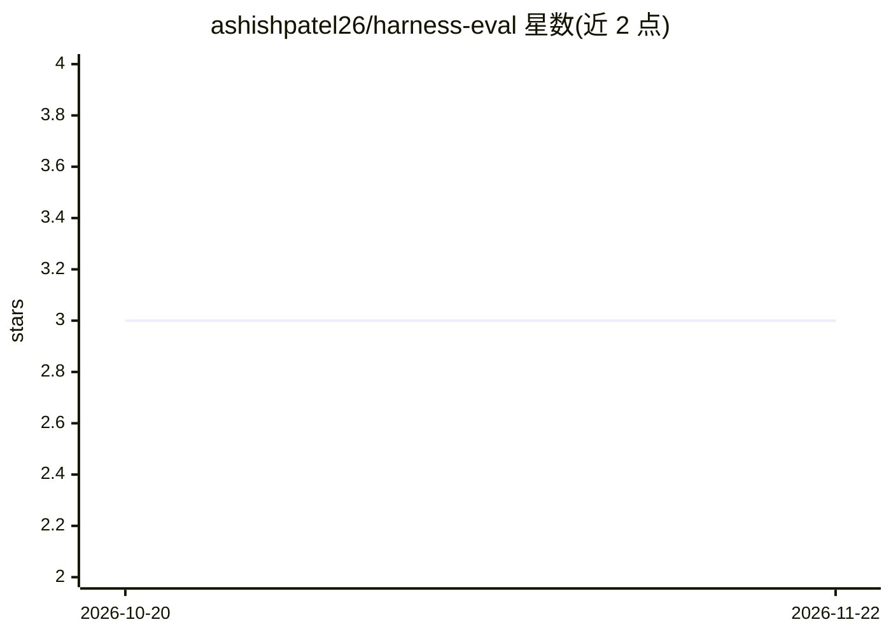

# ashishpatel26/harness-eval

⭐ 3 · Python · 推送 2026-10-07 · [GitHub](https://github.com/ashishpatel26/harness-eval) · 个人维护

**为 coding-agent harness 变更做配对重复评测并给出裁决的工具**

harness-eval 用同一组真实编码任务分别运行 baseline 与 candidate 两套 harness（AGENTS.md/CLAUDE.md、skills、MCP、模型、agent CLI 的目录组合），按 works/intent/conventions/cost 四维打分，输出 IMPROVEMENT/REGRESSION/INCONCLUSIVE/TRADE-OFF 裁决与可门禁 CI 的退出码。可信机制包括配对 per-task 差值、task+trial bootstrap 95% CI、A/A 校准噪声底线、私有 workspace 与 HOME 的隔离执行、隐藏测试事后注入与篡改检测。每次运行留下 JSON 记录、diff 与脱敏日志。

## 筛选速览

| 维度 | 判定 | 备注 |
|---|---|---|
| AI 角色 | `ai-ecosystem` | LLM/agent 周边工具 |
| 许可风险 | `none` | — |
| 部署形态 | `None` |  |
| 模型依赖 | local-ok | 支持本地模型 |
| 硬件要求 | — | 无带数字的原话,不猜 |
| 安装摩擦 | `low` | 无编译、无系统依赖或容器化 |
| 成熟度 | — | 结构信号不足 |

## 能力要点

- 配对重复评测：每任务每臂跑 N 次，bootstrap 95% CI 判定指标是否真实移动
- A/A 校准：baseline 对自身运行，测出噪声底线作为后续差值门槛
- 隔离执行：每次运行独立 workspace 与私有 HOME，拒绝祖先目录中的指令文件
- 退出码 0/1/2/3 分别对应四种裁决，可直接接入 CI 门禁

## 适用场景

- 评估修改 AGENTS.md 或新增 MCP server 后 coding agent 是否变好
- 在 CI 中用退出码门禁 harness 变更
- 用 A/A 校准测出评测噪声底线再比较真实变更
- 用本地 Ollama 免费跑通完整评测流程

## 场景标签

`模型评测` · 领域:评测与运维

## 证据(README 行号)

> L27: `harness-eval` runs the same real coding tasks with your current harness (**baseline**) and the
> L29: harness maintainer can act on, backed by confidence intervals and an evidence trail down to
> L35: |**Verdict**|`IMPROVEMENT` (exit 0) · `REGRESSION` (1) · `INCONCLUSIVE` (2) · `TRADE-OFF` (3), ready to gate CI.|
> L77: 3. **Execute**: each run gets a fresh workspace and a private home outside the user profile; the agent adapter (Cla

## 星数曲线

2026-10-20 3 → 2026-11-22 3（+0）

---
*卡片 v1 · prompt 1.4 · 生成 2026-11-22 · 置信度 high · 依据 README sha `202c1829fa31` · [字段定义](../../DATASET.md)*
