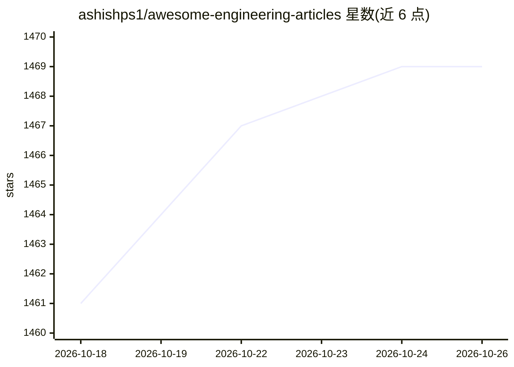

# ashishps1/awesome-engineering-articles

⭐ 1,469 · MIT · 推送 2026-03-01 · [GitHub](https://github.com/ashishps1/awesome-engineering-articles) · [官网](https://algomaster.io) · 个人维护

**300+ 篇科技公司工程博客文章的策展清单**

按公司组织的工程博客文章聚合清单：收录 Airbnb、Amazon、Meta、Google 等 20 余家科技公司的 300 余篇文章，每条列出标题、主题标签（AI/ML、数据工程、数据库、性能、架构等）与年份，覆盖搜索、基础设施、推荐系统、分布式系统等工程实践主题。内容为静态 Markdown 目录，面向希望系统学习大规模工程实践的开发者与架构师阅读，不提供代码或安装方式。

## 筛选速览

| 维度 | 判定 | 备注 |
|---|---|---|
| AI 角色 | `ai-knowledge` | 知识聚合/清单类 |
| 许可风险 | `permissive` | MIT |
| 部署形态 | `None` |  |
| 模型依赖 | — | README 未给出锁定关系 |
| 硬件要求 | — | 无带数字的原话,不猜 |
| 安装摩擦 | `low` | 无编译、无系统依赖或容器化 |
| 成熟度 | — | 结构信号不足 |

## 能力要点

- 按公司分章节组织，覆盖 20 余家科技公司的 300 余篇文章
- 每条目标注主题标签与发表年份
- 主题覆盖 AI/ML、数据工程、数据库、架构、性能等方向

## 适用场景

- 按公司或主题查找大规模系统设计的工程实践文章
- 学习搜索、推荐、数据基础设施等方向的业界案例
- 准备系统设计或架构面试时收集参考资料

## 场景标签

`精选清单` · 领域:学习与行业

## 证据(README 行号)

> L1: # Awesome Engineering Articles
> L2: > A curated collection of 300+ engineering blog articles from top tech companies. Learn how the best engineering tea

## 星数曲线

2026-10-18 1,461 → 2026-10-26 1,469（+8）

---
*卡片 v1 · prompt 1.4 · 生成 2026-10-21 · 置信度 high · 依据 README sha `f53d850c482c` · [字段定义](../../DATASET.md)*
