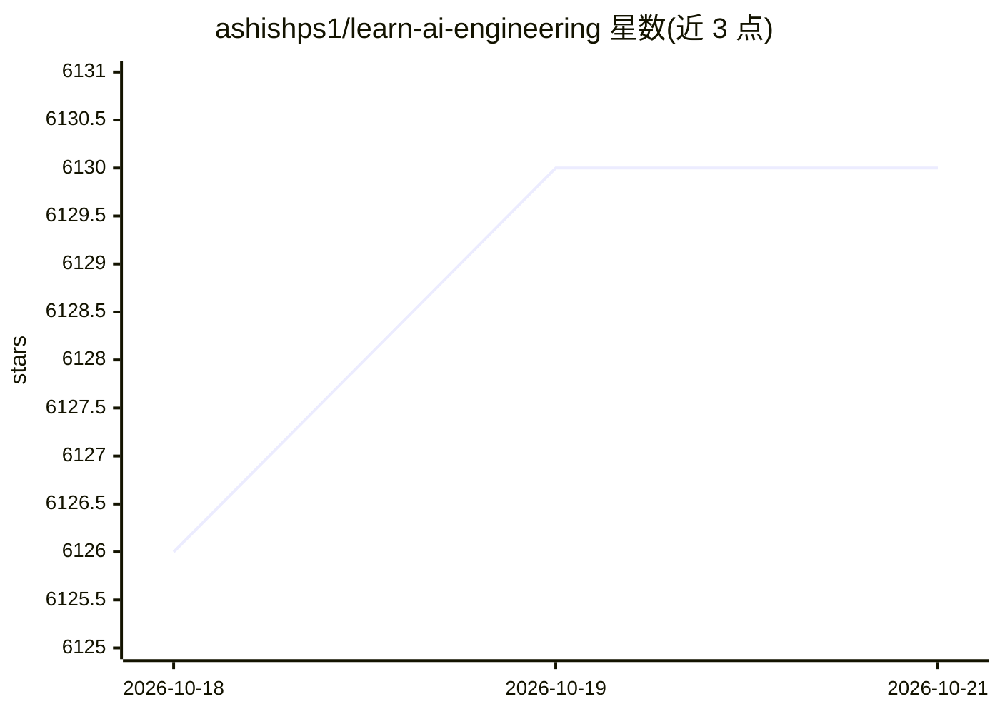

# ashishps1/learn-ai-engineering

⭐ 6,130 · GPL-3.0 · 推送 2026-02-05 · [GitHub](https://github.com/ashishps1/learn-ai-engineering) · 个人维护

**免费资源清单：系统学习 AI/ML、LLM 与 Agent 的课程与论文汇编**

一个学习资源聚合清单（awesome list 型），按主题分类收录免费学习材料：数学基础、Python、AI/ML 基础、深度学习框架（TensorFlow/PyTorch/Keras 等）、LLM、Prompt Engineering、RAG、AI Agents、MCP、MLOps 与部署、书籍、YouTube 频道和必读论文（Attention Is All You Need、GPT-3、BERT 等）。条目为课程、视频、书籍和 GitHub 仓库的链接列表，供学习者按路径自修使用；仓库本身不含代码或可运行工具。

## 筛选速览

| 维度 | 判定 | 备注 |
|---|---|---|
| AI 角色 | `ai-knowledge` | 知识聚合/清单类 |
| 许可风险 | `viral` | GPL-3.0 |
| 部署形态 | `None` |  |
| 模型依赖 | — | README 未给出锁定关系 |
| 硬件要求 | — | 无带数字的原话,不猜 |
| 安装摩擦 | `low` | 无编译、无系统依赖或容器化 |
| 成熟度 | — | 结构信号不足 |

## 能力要点

- 覆盖数学→ML→深度学习→LLM→Agent→MLOps 的分层学习路径
- 收录 7 篇必读 AI 论文与多本 'from Scratch' 系列书籍
- 涉及 LLM 工具链（LangChain/LlamaIndex/Ollama）与 MCP 主题的资源条目

## 适用场景

- 按路线图从零自学 AI/ML 与 LLM 工程
- 查找 Prompt Engineering、RAG、Agent、MCP 等专题的免费课程
- 查阅 AI 领域经典论文与书籍清单

## 场景标签

`精选清单` · 领域:学习与行业

## 证据(README 行号)

> L3: A comprehensive collection of free resources to learn everything about AI/ML, LLMs and Agents.
> L166: ## Must-Read AI Papers

## 星数曲线

2026-10-18 6,126 → 2026-10-21 6,130（+4）

---
*卡片 v1 · prompt 1.4 · 生成 2026-10-20 · 置信度 high · 依据 README sha `07f70e9c6ab7` · [字段定义](../../DATASET.md)*
