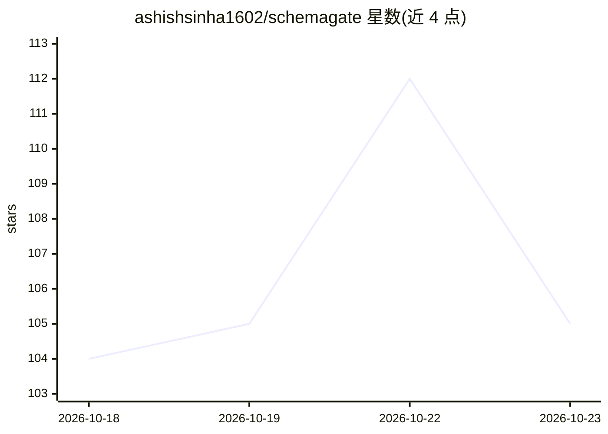

# ashishsinha1602/schemagate

⭐ 105 · Python · Apache-2.0 · 推送 2026-10-22 · [GitHub](https://github.com/ashishsinha1602/schemagate) · [官网](https://ashishsinha1602.github.io/schemagate/) · 个人维护

**给 text-to-SQL agent 的权限感知表筛选库，按调用者授权裁剪 schema**

面向 text-to-SQL 场景的访问控制与 schema 选择工具：在把表结构交给模型前，先按调用者（Principal/Role）的授权过滤目录，越权表不进入提示词；选择器本身不调用模型（BM25 加哈希嵌入器，离线运行），另可让模型重排（--rerank）。支持 Postgres、Oracle、MySQL、SQL Server、SQLite，兼容 LangChain、MCP 及任意 SQL agent。以 pip 包提供 CLI 与本地 Studio 页面，也提供 Docker 镜像；浏览器演示页为库的 JavaScript 移植并用 1,789 用例对拍。文档含从已归档的 Vanna 迁移指南。

## 筛选速览

| 维度 | 判定 | 备注 |
|---|---|---|
| AI 角色 | `ai-ecosystem` | LLM/agent 周边工具 |
| 许可风险 | `permissive` | Apache-2.0 |
| 部署形态 | `desktop` | 安装包/桌面程序 |
| 模型依赖 | — | README 未给出锁定关系 |
| 硬件要求 | — | 无带数字的原话,不猜 |
| 安装摩擦 | `low` | 无编译、无系统依赖或容器化 |
| 成熟度 | — | 结构信号不足 |

## 能力要点

- 在 schema 选择阶段按调用者授权裁剪，越权表不出现在提示词
- 选择器离线运行（BM25 + 哈希 n-gram 向量化），不调用模型
- 支持 Postgres/Oracle/MySQL/SQL Server/SQLite，可选模型重排（--rerank）
- 提供 CLI、本地 Studio 页面、Docker 镜像与浏览器演示

## 适用场景

- 在 text-to-SQL agent 中防止模型看到调用者无权读取的表
- 大型 schema 下裁剪提示词以降低 token 开销
- 带身份的问答：切换角色观察哪些表进入提示词

## 场景标签

`数据分析` · 领域:效率与自动化

## 证据(README 行号)

> L15: Your text-to-SQL agent picks which tables to show the model before anyone checks what the caller is allowed to read
> L45: schemagate demo "which customers owe us money" --answer --provider <provider> --model <model-id>
> L200: docker run -p 8770:8770 -e SCHEMAGATE_DATABASE_URL=postgresql://…   ghcr.io/ashishsinha1602/schemagate

## 星数曲线

2026-10-18 104 → 2026-10-23 105（+1）

---
*卡片 v1 · prompt 1.4 · 生成 2026-10-23 · 置信度 high · 依据 README sha `1d338797d05d` · [字段定义](../../DATASET.md)*
