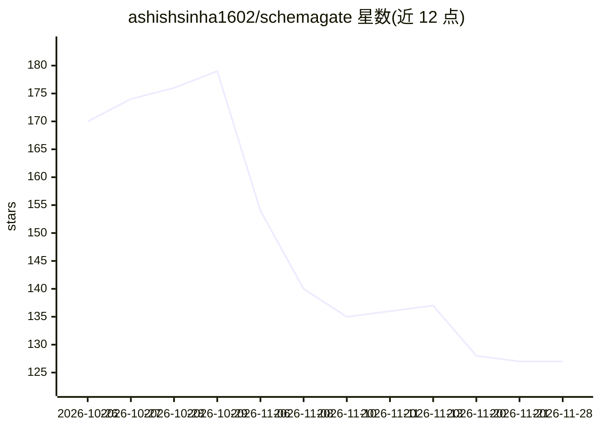

# ashishsinha1602/schemagate

⭐ 127 · Python · Apache-2.0 · 推送 2026-11-27 · [GitHub](https://github.com/ashishsinha1602/schemagate) · [官网](https://ashishsinha1602.github.io/schemagate/) · 个人维护

**Text-to-SQL 的按权限裁剪 schema 中间件：只给 LLM 调用者可读的表**

在 text-to-SQL 流程中做身份感知的表选择：按调用者的授权过滤目录，受限表直接不进入 prompt，而非排序靠后；选择器本身不调用模型，用 BM25 加哈希嵌入器离线运行。面向用 LangChain、LlamaIndex、MCP 或任意 SQL agent 的开发者，支持 Postgres、Oracle、MySQL、SQL Server 与 SQLite。依赖仅 SQLAlchemy，无 API key；可选 extras 提供各数据库驱动与模型服务接入，另提供 Docker 镜像与浏览器演示页。

## 筛选速览

| 维度 | 判定 | 备注 |
|---|---|---|
| AI 角色 | `ai-ecosystem` | LLM/agent 周边工具 |
| 许可风险 | `permissive` | Apache-2.0 |
| 部署形态 | `desktop` | 安装包/桌面程序 |
| 模型依赖 | locked-api |  |
| 硬件要求 | — | 无带数字的原话,不猜 |
| 安装摩擦 | `low` | 无编译、无系统依赖或容器化 |
| 成熟度 | — | 结构信号不足 |

## 能力要点

- 按调用者授权过滤 schema，受限表名不出现在 prompt 中
- 选择器不调用模型：BM25+哈希嵌入器，离线毫秒级、跨机器结果一致
- 支持 LangChain、LlamaIndex、MCP 与任意 SQL agent 接入
- 提供 schemagate studio 本地页面与浏览器演示（1,789 个用例与 Python 版对齐）

## 适用场景

- 多角色访问同一数据库的分析平台，按权限裁剪 prompt
- 大 schema（50+ 表）下降低 text-to-SQL 的 token 成本
- 为 MCP server 或 SQL agent 接入权限感知的 schema 选择
- 用本地模型路径避免数据离开本机

## 场景标签

`数据分析` · 领域:效率与自动化

## 证据(README 行号)

> L18: Most text-to-SQL prompts carry the whole schema, and on a big database that is most of the prompt, on every questio
> L155: itself never calls a model (BM25 plus a hashed embedder, offline,
> L193: That's the whole thing. One dependency (SQLAlchemy), no API key, no model

## 星数曲线

2026-10-26 170 → 2026-11-28 127（-43）

---
*卡片 v1 · prompt 1.4 · 生成 2026-11-28 · 置信度 mid · 依据 README sha `093f18edaa5e` · [字段定义](../../DATASET.md)*
