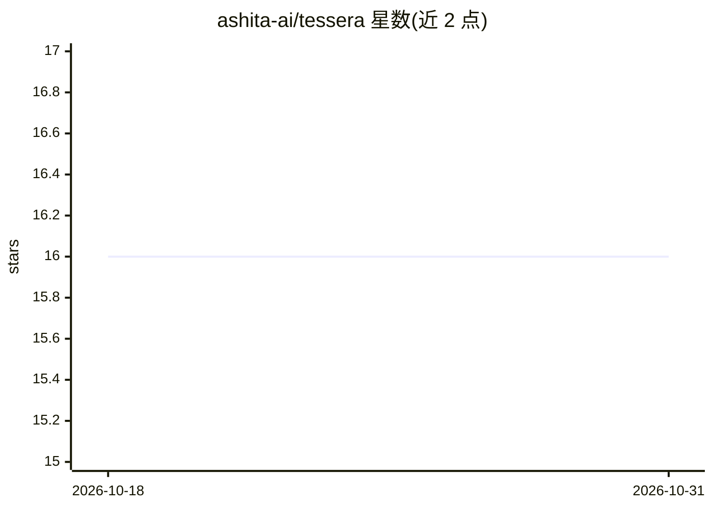

# ashita-ai/tessera

⭐ 16 · Python · Apache-2.0 · 推送 2026-04-10 · [GitHub](https://github.com/ashita-ai/tessera) · [官网](https://ashita-ai.github.io/tessera/) · 组织维护

**API/数据契约协调服务器：破坏性变更需消费者确认后才发布**

自托管的服务契约协调系统：生产者发布 schema 契约（OpenAPI、GraphQL、gRPC、dbt、JSON Schema 统一规范化），消费者注册依赖；当出现破坏性变更时创建 proposal 并通知所有下游消费者，全部确认后才发布，非破坏性变更自动发布。提供服务依赖图、影响分析、兼容性模式（对齐 Kafka Schema Registry 语义）、数据质量保障、签名 Webhook 与审计日志，含 React Web UI 与 Git 仓库自动同步后台任务。AI 角色限于集成：agent 可注册为消费者并参与 proposal 流程。需 PostgreSQL，Redis 为可选缓存。

## 筛选速览

| 维度 | 判定 | 备注 |
|---|---|---|
| AI 角色 | `ai-enhanced` | 去掉 AI 部分产品仍成立 |
| 许可风险 | `permissive` | Apache-2.0 |
| 部署形态 | `self-host` | docker 或自建部署 |
| 模型依赖 | — | README 未给出锁定关系 |
| 硬件要求 | — | 无带数字的原话,不猜 |
| 安装摩擦 | `low` | 无编译、无系统依赖或容器化 |
| 成熟度 | — | 结构信号不足 |

## 能力要点

- 破坏性变更的 proposal-acknowledgment 工作流，阻塞发布直至全部下游确认
- 多格式 sync 适配器（OpenAPI/GraphQL/gRPC/dbt）统一规范化为 JSON Schema 做同一套 diff 与兼容性检查
- 服务依赖图 API、递归下游影响分析与只追加审计日志
- Git 仓库注册后自动 clone、发现 spec 并发布契约的后台同步 worker

## 适用场景

- 微服务团队协调 API schema 变更，避免下游在半夜被告警唤醒
- 在发布前分析某字段变更会影响哪些下游服务与团队
- 让 AI agent 在修改 schema 前查询契约并参与变更确认流程

## 场景标签

 · 领域:数据/API 治理

## 证据(README 行号)

> L18: When a producer publishes a breaking change, Tessera creates a proposal, notifies every registered consumer, and bl
> L33: Tessera makes dependencies explicit and breaking changes coordinated. It works the same way regardless of source fo
> L85: - **AI agent integration** — Agents register as consumers, check contracts before modifying schemas, and participat

## 星数曲线

2026-10-18 16 → 2026-10-31 16（+0）

---
*卡片 v1 · prompt 1.4 · 生成 2026-10-30 · 置信度 mid · 依据 README sha `1bbd5f94fba6` · [字段定义](../../DATASET.md)*
