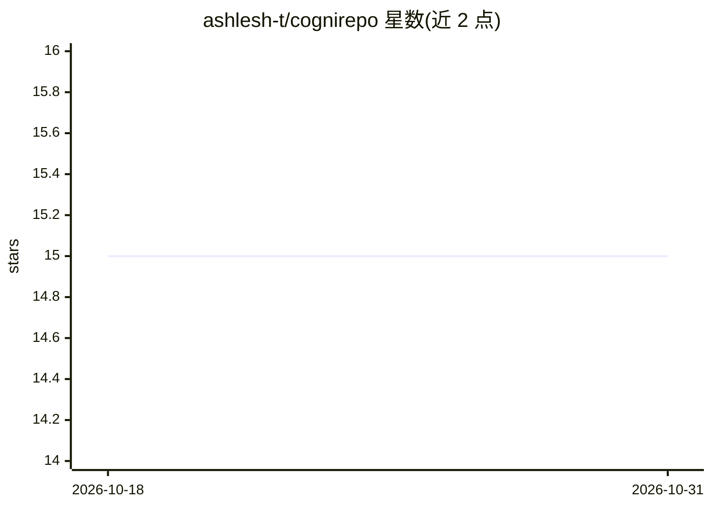

# ashlesh-t/cognirepo

⭐ 15 · Python · MIT · 推送 2026-10-29 · [GitHub](https://github.com/ashlesh-t/cognirepo) · [官网](https://ashlesh-t.github.io/cognirepo-site/) · 个人维护

**AI 编码代理的本地记忆与仓库索引基础设施（MCP 工具）**

面向 Claude Code、Cursor、Gemini CLI 等 AI 编码工具的 MCP 服务器：在代码库与 AI 工具之间提供语义记忆（FAISS + sentence-transformer）、事件日志、代码知识图谱、AST 反向索引（O(1) 符号查找）、用户偏好画像与错误追踪，共 36 个 MCP 工具，宣称降低 token 消耗。索引与全部 MCP 工具离线运行无需 API key（仅 ask 命令需要）。最适用于 ≥15K LOC 的 Python 仓库，动态分发等场景存在已声明的局限。以 pipx/pip 安装，另提供 Docker 与各客户端接入配置。

## 筛选速览

| 维度 | 判定 | 备注 |
|---|---|---|
| AI 角色 | `ai-ecosystem` | LLM/agent 周边工具 |
| 许可风险 | `permissive` | MIT |
| 部署形态 | `self-host` | docker 或自建部署 |
| 模型依赖 | locked-api |  |
| 硬件要求 | `cpu-ok` | |
| 安装摩擦 | `low` | 无编译、无系统依赖或容器化 |
| 成熟度 | — | 结构信号不足 |

## 能力要点

- FAISS 语义记忆 + NetworkX 知识图谱 + AST 反向索引
- 36 个 MCP 工具全部离线可用，无需 API key
- 跨 agent 上下文交接（last_context.json 共享）
- 用户偏好画像与错误模式追踪跨会话持久化

## 适用场景

- 让 Claude/Cursor 在大型代码库中低 token 成本地检索代码与历史决策
- 跨会话、跨工具保留项目记忆与架构决策记录
- 微服务多仓库组织级知识图谱查询

## 场景标签

`Agent 记忆` `知识图谱` · 领域:Agent 开发

## 证据(README 行号)

> L4: > Persistent memory and context for any AI tool. Not a chatbot — infrastructure.
> L24: It sits between your codebase and any AI tool, providing:
> L217: All 36 tools are available to Claude, Cursor, and any MCP-compatible client.

## 星数曲线

2026-10-18 15 → 2026-10-31 15（+0）

---
*卡片 v1 · prompt 1.4 · 生成 2026-10-30 · 置信度 high · 依据 README sha `a83326a6cd2b` · [字段定义](../../DATASET.md)*
