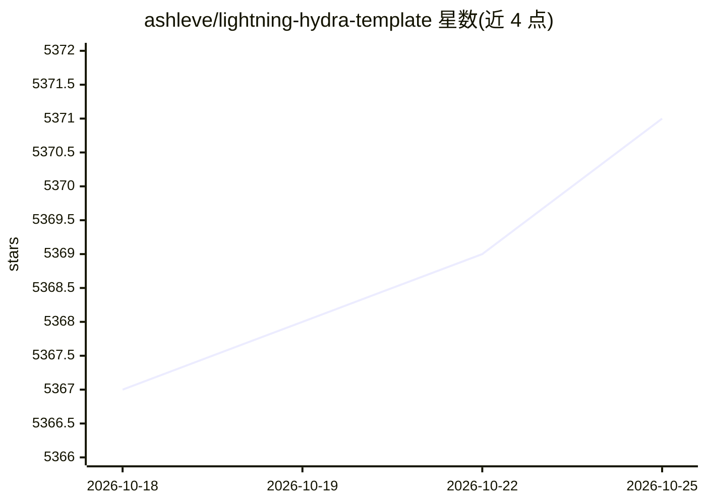

# ashleve/lightning-hydra-template

⭐ 5,372 · Python · 推送 2026-06-11 · [GitHub](https://github.com/ashleve/lightning-hydra-template) · 个人维护

**深度学习实验项目模板：PyTorch Lightning + Hydra 快速起步**

以 PyTorch Lightning 与 Hydra 为基础的深度学习项目脚手架模板，通过 Use this template 初始化仓库。提供分层配置体系（主配置 + 实验配置）、命令行覆盖任意超参、从配置动态实例化模型与数据模块、多 GPU/TPU/SLURM 训练、实验追踪（Tensorboard/W&B/MLFlow 等）、Optuna 超参搜索、pre-commit 与 pytest 测试等 MLOps 实践。README 同时列出局限：DDP 模式存在问题、不适用于相互依赖的数据管道、配置体系面向简单训练场景。内置 MNIST 示例。

## 筛选速览

| 维度 | 判定 | 备注 |
|---|---|---|
| AI 角色 | `ai-ecosystem` | LLM/agent 周边工具 |
| 许可风险 | `none` | — |
| 部署形态 | `library` | 以包/库形式分发 |
| 模型依赖 | — | README 未给出锁定关系 |
| 硬件要求 | — | 无带数字的原话,不猜 |
| 安装摩擦 | `low` | 无编译、无系统依赖或容器化 |
| 成熟度 | — | 结构信号不足 |

## 能力要点

- Hydra 主配置 + 实验配置的两层配置体系，命令行可覆盖任意参数
- 模块路径由配置指定，通过 hydra.utils.instantiate 动态实例化模型/数据模块
- 支持 CPU/GPU/多 GPU/TPU/SLURM 集群训练与混合精度
- 集成 Tensorboard、W&B、Neptune、Comet、MLFlow、CSV 实验追踪与 Optuna 超参搜索

## 适用场景

- 初始化一个结构规范、可直接训练的深度学习项目
- 通过命令行切换模型/数据模块并做超参扫描
- 以带注释的代码结构学习 Lightning 与 Hydra 的组织方式

## 场景标签

`MLOps` · 领域:训练与推理

## 证据(README 行号)

> L16: A clean template to kickstart your deep learning project 🚀⚡🔥
> L52: PyTorch Lightning - a lightweight PyTorch wrapper for high-performance AI research. Think of it as a framework for 
> L54: Hydra - a framework for elegantly configuring complex applications. The key feature is the ability to dynamically c

## 星数曲线

2026-10-18 5,367 → 2026-10-25 5,371（+4）

---
*卡片 v1 · prompt 1.4 · 生成 2026-10-20 · 置信度 mid · 依据 README sha `c73e3b6bb378` · [字段定义](../../DATASET.md)*
