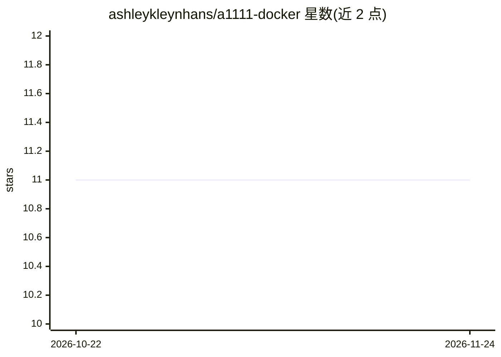

# ashleykleynhans/a1111-docker

⭐ 11 · Shell · GPL-3.0 · 推送 2026-04-15 · [GitHub](https://github.com/ashleykleynhans/a1111-docker) · 个人维护

**打包 Stable Diffusion WebUI 及常用扩展的 Docker 镜像**

提供预装 A1111 Stable Diffusion Web UI 1.10.1 的 Docker 镜像，按 CUDA 12.4/12.8 与 Python 3.11/3.12 分为四个变体，并内置 ControlNet、After Detailer、ReActor、Deforum 等 12 个扩展、inswapper_128 换脸模型、Jupyter Lab、code-server 及 RunPod 相关工具。镜像面向 RunPod 部署设计，也支持本地 docker run 启动；构建镜像缓存模型时声明需要至少 32GB 系统内存，运行需 NVIDIA CUDA 驱动。

## 筛选速览

| 维度 | 判定 | 备注 |
|---|---|---|
| AI 角色 | `ai-ecosystem` | LLM/agent 周边工具 |
| 许可风险 | `viral` | GPL-3.0 |
| 部署形态 | `self-host` | docker 或自建部署 |
| 模型依赖 | — | README 未给出锁定关系 |
| 硬件要求 | — | 无带数字的原话,不猜 |
| 安装摩擦 | `low` | 无编译、无系统依赖或容器化 |
| 成熟度 | — | 结构信号不足 |

## 能力要点

- 四个镜像变体（CUDA 12.4/12.8 × Python 3.11/3.12），附 PyTorch 与 xformers 版本
- 预装 12 个 WebUI 扩展（ControlNet、ADetailer、ReActor、Deforum 等）与 inswapper_128.onnx
- 面向 RunPod 提供部署模板，内置 runpodctl、rclone、croc 等工具
- 同时暴露 WebUI、Jupyter Lab、code-server 等多端口服务

## 适用场景

- 在 RunPod 上一键部署 Stable Diffusion WebUI 云端实例
- 本地 GPU 环境用 Docker 快速搭建含扩展的图像生成工作区
- 通过 Jupyter Lab/code-server 在同一容器内做训练与开发

## 场景标签

`图像生成` · 领域:内容生成

## 证据(README 行号)

> L1: # Docker image for A1111 Stable Diffusion Web UI
> L44: This image is designed to work on RunPod.
> L20:  https://github.com/AUTOMATIC1111/stable-diffusion-webui) 1.10.1

## 星数曲线

2026-10-22 11 → 2026-11-24 11（+0）

---
*卡片 v1 · prompt 1.4 · 生成 2026-11-18 · 置信度 high · 依据 README sha `eefd89984b96` · [字段定义](../../DATASET.md)*
