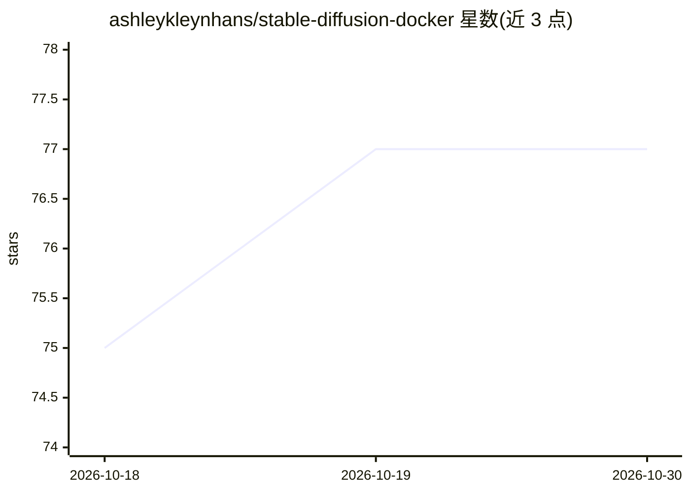

# ashleykleynhans/stable-diffusion-docker

⭐ 77 · Shell · GPL-3.0 · 推送 2026-10-27 · [GitHub](https://github.com/ashleykleynhans/stable-diffusion-docker) · 个人维护

**打包 A1111/Kohya_ss/ComfyUI/InvokeAI 的 Stable Diffusion Docker 镜像**

面向 RunPod GPU 云与本地部署的 Stable Diffusion 整合 Docker 镜像：内含 Ubuntu 22.04、CUDA 12.4、Torch 2.6.0 环境，预装 A1111 Web UI 及 ControlNet、After Detailer、ReActor、Deforum 等扩展，另含 Kohya_ss v26.0.0、ComfyUI v0.42.1、InvokeAI v6.14.2 与 Jupyter Lab、code-server 等工具。提供 RunPod 模板一键启动，也支持本地安装 NVIDIA CUDA 驱动后 docker run 运行；构建镜像缓存模型时需至少 32GB 系统内存。各服务通过不同端口暴露并输出独立日志文件。

## 筛选速览

| 维度 | 判定 | 备注 |
|---|---|---|
| AI 角色 | `ai-ecosystem` | LLM/agent 周边工具 |
| 许可风险 | `viral` | GPL-3.0 |
| 部署形态 | `self-host` | docker 或自建部署 |
| 模型依赖 | — | README 未给出锁定关系 |
| 硬件要求 | — | 无带数字的原话,不猜 |
| 安装摩擦 | `low` | 无编译、无系统依赖或容器化 |
| 成熟度 | — | 结构信号不足 |

## 能力要点

- 单镜像预装 A1111 Web UI、Kohya_ss、ComfyUI、InvokeAI 四个应用
- 预装 ControlNet、After Detailer、ReActor、Deforum 等十余个扩展
- 提供 RunPod 官方模板与本地 docker run 两种运行方式
- 内置 Jupyter Lab、code-server、Tensorboard、croc/rclone 等配套工具

## 适用场景

- 在 RunPod 上一键部署带常用扩展的 Stable Diffusion 工作环境
- 在本地 GPU 服务器用 Docker 运行多个 Stable Diffusion Web UI
- 用 Kohya_ss 和 Dreambooth 训练/微调模型，ComfyUI 搭建工作流

## 场景标签

`图像生成` `微调` · 领域:内容生成

## 证据(README 行号)

> L21: * [Automatic1111 Stable Diffusion Web UI](
> L36: * Kohya_ss v26.0.0
> L37: * ComfyUI v0.42.1
> L39: * InvokeAI v6.14.2

## 星数曲线

2026-10-18 75 → 2026-10-30 77（+2）

---
*卡片 v1 · prompt 1.4 · 生成 2026-10-24 · 置信度 high · 依据 README sha `da66804986f8` · [字段定义](../../DATASET.md)*
