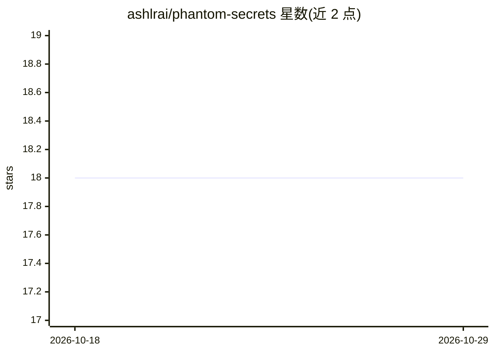

# ashlrai/phantom-secrets

⭐ 18 · Rust · MIT · 推送 2026-10-28 · [GitHub](https://github.com/ashlrai/phantom-secrets) · [官网](https://phm.dev/secrets) · 个人维护

**给开发者的密钥隔离代理：AI 编码代理用密钥但看不到真实值**

面向使用 AI 编码代理的开发者的本地密钥隔离工具：phantom init 将 .env 中的真实密钥存入系统凭据库或加密文件，并把 .env 改写为 phm_ 占位符；phantom exec 启动本地反向代理，拦截 API 请求并在转发前注入该路由对应的确切认证头，客户端 SDK 无需修改。代理会话靠 PHANTOM_PROXY_TOKEN 认证。另提供 MCP 服务器（phantom-mcp），供 Claude Code、Cursor、Windsurf、Codex、Gemini CLI 等客户端进行值盲的清单与诊断操作。README 明确列出安全边界：未纳管文件、同用户进程仍在威胁模型内；phantom_do 仅提案不执行；泄漏率评测为脚本化攻击场景而非真实 LLM。

## 筛选速览

| 维度 | 判定 | 备注 |
|---|---|---|
| AI 角色 | `ai-ecosystem` | LLM/agent 周边工具 |
| 许可风险 | `permissive` | MIT |
| 部署形态 | `desktop` | 安装包/桌面程序 |
| 模型依赖 | — | README 未给出锁定关系 |
| 硬件要求 | — | 无带数字的原话,不猜 |
| 安装摩擦 | `medium` | 含编译或系统依赖之一 |
| 成熟度 | — | 结构信号不足 |

## 能力要点

- phantom init 将 .env 真实密钥替换为 phm_ 占位符并存入 OS 凭据库或加密文件
- 本地反向代理按路由注入确切认证头，客户端 SDK 无需修改（*_BASE_URL 指向本地）
- 值盲 MCP 工具与 Claude Code、Cursor、Windsurf、Codex、Gemini CLI 的安装辅助集成
- 脚本化对手泄漏率评测：phantom init 后 450 次边界内攻击 0 次暴露金丝雀密钥（单机、非外部审计）

## 适用场景

- 让 AI 编码代理调用付费 API 而不把真实密钥放进代理上下文或转录
- 团队在采用 AI 编码工具前对项目密钥做隔离与审计
- 配合 CI 使用 phantom check --staged 与 pre-commit 钩子防止密钥入库

## 场景标签

`网络安全` · 领域:学习与行业

## 证据(README 行号)

> L9: Phantom replaces project secrets with scoped `phm_` placeholders. Applications use those placeholders through an aut
> L72: - 🧰 **Agent-native integrations**: setup helpers and value-blind MCP workflows for Claude Code, Cursor, Windsurf, C
> L182: 1. `phantom init` reads `.env`, stores real secrets in the native OS credential store or encrypted-file fallback, 

## 星数曲线

2026-10-18 18 → 2026-10-29 18（+0）

---
*卡片 v1 · prompt 1.4 · 生成 2026-10-29 · 置信度 high · 依据 README sha `adf4affcd895` · [字段定义](../../DATASET.md)*
