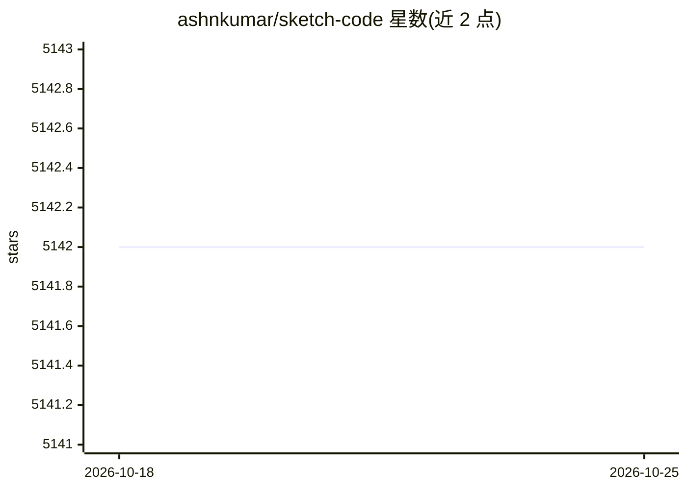

# ashnkumar/sketch-code

⭐ 5,142 · Python · MIT · 推送 2026-08-06 · [GitHub](https://github.com/ashnkumar/sketch-code) · 个人维护

**从手绘网页线框图生成 HTML 代码的 Keras 深度学习模型**

基于 Keras/TensorFlow 1.x 实现的图像描述（image captioning）模型：CNN 编码器接 LSTM 解码器，把手绘网页线框图作为输入图像、HTML 标记作为"描述"生成代码。训练依赖 1,700 张合成图像数据集（来自 pix2code 架构与数据），提供预训练权重、单图/批量转换脚本、训练脚本与 BLEU 评估。项目构建于 2018 年 Insight AI Fellowship，明确声明不再维护，性能依赖与训练集相近的线框图。

## 筛选速览

| 维度 | 判定 | 备注 |
|---|---|---|
| AI 角色 | `ai-native` | 本体是模型或模型工具 |
| 许可风险 | `permissive` | MIT |
| 部署形态 | `library` | 以包/库形式分发 |
| 模型依赖 | — | README 未给出锁定关系 |
| 硬件要求 | — | 无带数字的原话,不猜 |
| 安装摩擦 | `low` | 无编译、无系统依赖或容器化 |
| 成熟度 | `idea` | |

## 能力要点

- CNN+LSTM 图像描述架构，将手绘线框转为 HTML 代码
- 提供预训练权重与单图/批量转换 CLI 脚本
- 支持从零训练与 BLEU 评分评估
- 基于 pix2code 的合成数据集（1,700 张图像）

## 适用场景

- 用手绘线框图快速生成网页 HTML 原型
- 研究图像描述架构在前端代码生成上的应用
- 复现 2018 年图像转代码方向的方法

## 场景标签

`代码生成` · 领域:编码与开发

## 证据(README 行号)

> L15: SketchCode is a deep learning model that takes hand-drawn web mockups and converts them into working HTML code. It 
> L11: > synthetic dataset it was trained on. The code targets TensorFlow 1.x and Keras of that era and is

## 星数曲线

2026-10-18 5,142 → 2026-10-25 5,142（+0）

---
*卡片 v1 · prompt 1.4 · 生成 2026-10-20 · 置信度 mid · 依据 README sha `fc689d7904ae` · [字段定义](../../DATASET.md)*
