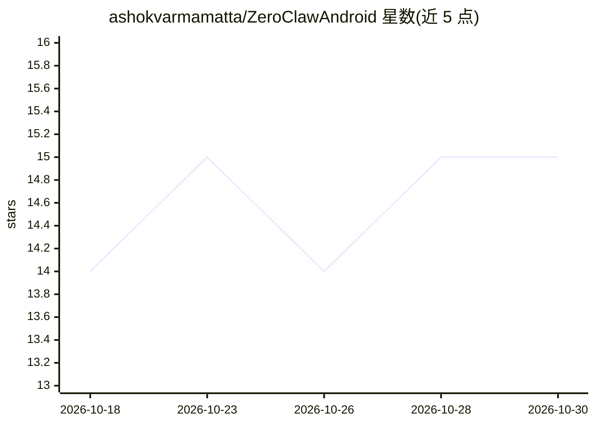

# ashokvarmamatta/ZeroClawAndroid

⭐ 15 · Kotlin · MIT · 推送 2026-05-04 · [GitHub](https://github.com/ashokvarmamatta/ZeroClawAndroid) · 个人维护

**Android 常驻 AI agent 应用：手机 24/7 连接聊天平台与多 LLM**

Kotlin/Compose 编写的 Android 前台服务应用，后台 24/7 运行 AI agent：接入 11 种聊天平台（Telegram、WhatsApp、Discord 等），提供 30 个 AI 工具、25+ 自动监控 agent 模板，并支持多 LLM 供应商（Gemini、OpenAI、Anthropic、OpenRouter、Ollama 及 LiteRT 离线 Gemma）自动故障转移。内置 8088 端口的 OpenAI 兼容 API 服务器，可被 Cursor、LangChain 等客户端连接，经 Cloudflare Tunnel（cloudflared 二进制内置 APK）公网可达。构建需 Android Studio 从源码编译，需至少一个 AI API key。

## 筛选速览

| 维度 | 判定 | 备注 |
|---|---|---|
| AI 角色 | `ai-native` | 本体是模型或模型工具 |
| 许可风险 | `permissive` | MIT |
| 部署形态 | `None` |  |
| 模型依赖 | local-ok | 支持本地模型 |
| 硬件要求 | — | 无带数字的原话,不猜 |
| 安装摩擦 | `low` | 无编译、无系统依赖或容器化 |
| 成熟度 | — | 结构信号不足 |

## 能力要点

- 11 种聊天平台接入，30 个 AI 工具
- 多 LLM 供应商无限 API key 自动故障转移
- 8088 端口 OpenAI 兼容 API 服务器，供任意 OpenAI SDK 应用连接
- 内置 cloudflared ARM64 二进制的 Cloudflare Tunnel 公网访问
- LiteRT 离线运行 Gemma 4（32K 上下文）

## 适用场景

- 用手机全天候托管个人 AI 助手并通过聊天软件对话
- 定时监控网页/加密货币/新闻并自动推送变更到聊天平台
- 把手机当作 OpenAI 兼容 API 服务器供 Cursor、LangChain 等工具调用

## 场景标签

`AI 助手` `模型网关` · 领域:Agent 开发

## 证据(README 行号)

> L34: An Android app that runs AI **in the background 24/7**. It connects to your chat apps, gives you 30 AI tools, and l
> L20: > 🤔 **Can it serve as an API server?** → Yes, on port 8088 — any OpenAI-compatible app can connect.

## 星数曲线

2026-10-18 14 → 2026-10-30 15（+1）

---
*卡片 v1 · prompt 1.4 · 生成 2026-10-30 · 置信度 high · 依据 README sha `f39b3e2a0523` · [字段定义](../../DATASET.md)*
