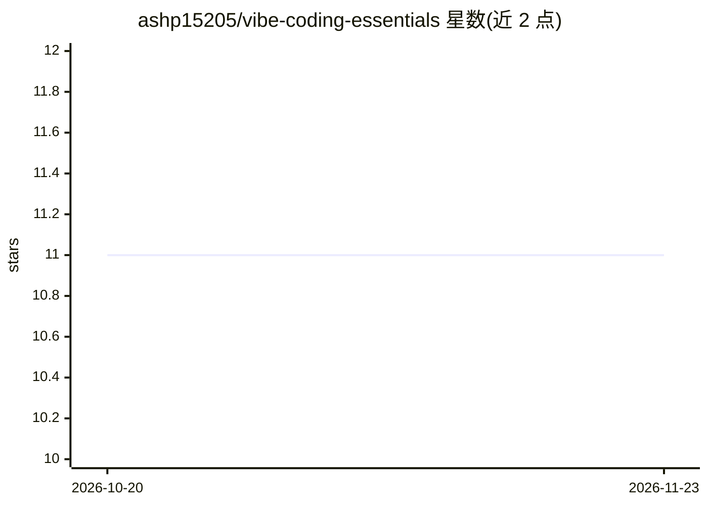

# ashp15205/vibe-coding-essentials

⭐ 11 · MIT · 推送 2026-07-05 · [GitHub](https://github.com/ashp15205/vibe-coding-essentials) · 个人维护

**AI 辅助开发的流程规则集：四种模式与防幻觉守则**

面向 AI 辅助开发者的工作流方法论仓库：提供四种运行模式（经济/构建/维护/架构）定义与切换流程、25 条黄金规则、防幻觉守则、10 个失败案例与上下文恢复工具清单，并给出适配 Cursor、Windsurf、Copilot 等工具的配置模板，通过复制 AGENTS.md 到项目根目录并以模式标签前缀控制 AI 行为。附 qwen3:8b 本地模型的基准对比数据。

## 筛选速览

| 维度 | 判定 | 备注 |
|---|---|---|
| AI 角色 | `ai-knowledge` | 知识聚合/清单类 |
| 许可风险 | `permissive` | MIT |
| 部署形态 | `None` |  |
| 模型依赖 | — | README 未给出锁定关系 |
| 硬件要求 | — | 无带数字的原话,不猜 |
| 安装摩擦 | `low` | 无编译、无系统依赖或容器化 |
| 成熟度 | — | 结构信号不足 |

## 能力要点

- 四种运行模式及各自的接受/拒绝行为边界
- anti-hallucination/ 目录提供 9 个框架的专属守则
- templates/ 目录含 Cursor、Windsurf、Copilot 配置模板
- 以模式标签前缀（如 [ECONOMY]）切换任务行为

## 适用场景

- 控制 AI 编码助手生成代码的规模与范围
- 在多会话开发中迁移和恢复上下文
- 为不同 IDE/编码工具配置 AI 行为规则

## 场景标签

`编码 Agent` · 领域:编码与开发

## 证据(README 行号)

> L78: - `SKILL.md`: The 11 core meta-skills required to manage AI agents effectively.
> L86: - `templates/`: Ready-to-use configuration files for Cursor, Windsurf, Copilot, and CLI tools.

## 星数曲线

2026-10-20 11 → 2026-11-23 11（+0）

---
*卡片 v1 · prompt 1.4 · 生成 2026-11-18 · 置信度 high · 依据 README sha `29b70c58cc27` · [字段定义](../../DATASET.md)*
