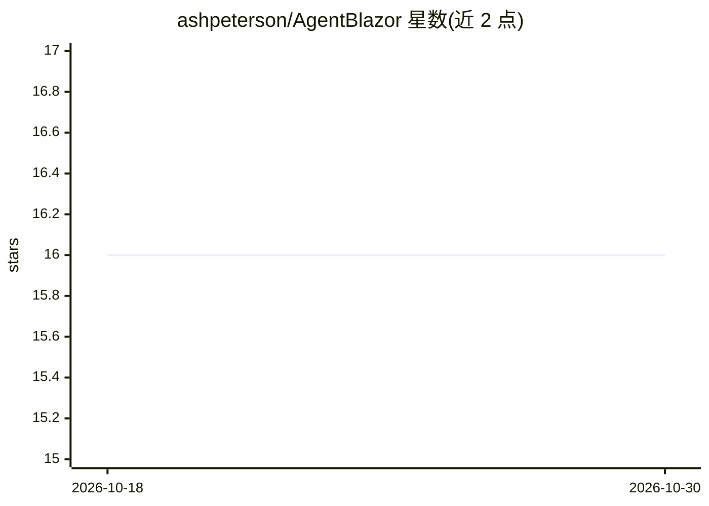

# ashpeterson/AgentBlazor

⭐ 16 · C# · 推送 2026-06-18 · [GitHub](https://github.com/ashpeterson/AgentBlazor) · [官网](https://demo.agentblazor.com/demo/workflows/support-inbox) · 个人维护

**给 .NET/Blazor 应用的 AI agent 聊天组件与工作流库**

以 NuGet 包形式为 Blazor 应用提供 agent 聊天界面组件：声明式能力类（AgentCapability）、审批门控动作与确定性 UI 执行，不替换原有应用 UI。构建于 Microsoft Agent Framework 的四个 GA 包之上，预览版托管包被封装在自有注册层后。提供可选 CLI 脚手架、EF Core 模式暴露扩展包（仅 schema、不执行查询）、起始示例工程与托管演示站点。当前处于 Beta 阶段（0.2.x），要求 0.2.5 或更高版本。

## 筛选速览

| 维度 | 判定 | 备注 |
|---|---|---|
| AI 角色 | `ai-ecosystem` | LLM/agent 周边工具 |
| 许可风险 | `none` | — |
| 部署形态 | `None` |  |
| 模型依赖 | — | README 未给出锁定关系 |
| 硬件要求 | — | 无带数字的原话,不猜 |
| 安装摩擦 | `high` | 编译与系统依赖俱全 |
| 成熟度 | `idea` | |

## 能力要点

- Blazor 路由上添加带审批门控动作的 agent 聊天界面
- 基于 Microsoft Agent Framework GA 包而非自研运行时
- 可选 EF Core 扩展：仅暴露实体 schema 供规划，不执行查询
- 可选 CLI 脚手架与托管演示站点

## 适用场景

- 在现有 Blazor 应用中添加支持审批的 AI agent 聊天入口
- 让 agent 通过类型化 AgentAction 方法安全调用应用能力
- 将 EF Core 实体结构作为 agent 规划上下文暴露

## 场景标签

`Agent 框架` · 领域:Agent 开发

## 证据(README 行号)

> L5: Add an agent chat surface and deterministic app actions to a Blazor app.
> L25: AgentBlazor builds on the Microsoft Agent Framework packages rather than a custom agent runtime. The core package c
> L7: AgentBlazor gives a Blazor route a chat surface, explicit capabilities, approval-gated actions, and deterministic UI

## 星数曲线

2026-10-18 16 → 2026-10-30 16（+0）

---
*卡片 v1 · prompt 1.4 · 生成 2026-10-30 · 置信度 high · 依据 README sha `de21a9a62c3c` · [字段定义](../../DATASET.md)*
