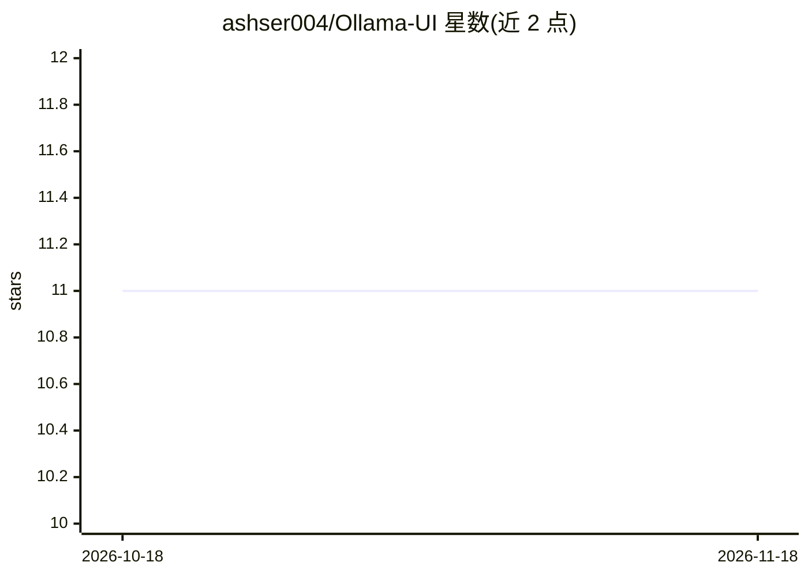

# ashser004/Ollama-UI

⭐ 11 · Python · MIT · 推送 2026-05-27 · [GitHub](https://github.com/ashser004/Ollama-UI) · 个人维护

**面向个人用户的离线 Ollama 模型图形界面与管理工作区**

以 Ollama 为引擎的桌面客户端，用 Python 与 PySide6 构建，提供模型浏览下载、对话、图像生成与本地网络分享功能。内置模型商店按硬件 RAM 过滤 30+ 模型，动态管理上下文内存（上限 16,384 tokens），支持多模态图像对话与基于 Stable Diffusion 的文生图（自动检测 NVIDIA GPU 选择 CUDA 或 CPU 引擎）。支持从 USB 便携运行，可开局域网服务器供最多 3 台设备浏览器访问。Windows 提供安装包，亦可源码构建。

## 筛选速览

| 维度 | 判定 | 备注 |
|---|---|---|
| AI 角色 | `ai-native` | 本体是模型或模型工具 |
| 许可风险 | `permissive` | MIT |
| 部署形态 | `desktop` | 安装包/桌面程序 |
| 模型依赖 | local-ok | 支持本地模型 |
| 硬件要求 | `cpu-ok` | |
| 安装摩擦 | `medium` | 含编译或系统依赖之一 |
| 成熟度 | — | 结构信号不足 |

## 能力要点

- 内置模型商店按可用 RAM 过滤并下载 30+ 模型
- 动态上下文内存管理，最高 16,384 tokens
- Stable Diffusion 文生图，自动检测 NVIDIA GPU 下载 CUDA 引擎
- 局域网服务器模式，最多 3 台设备同时访问

## 适用场景

- 在无网络环境下本地运行大模型对话
- 通过图形界面管理 Ollama 模型的下载与切换
- 在家庭局域网内分享本地 AI 给手机等设备使用
- 离线生成图片

## 场景标签

`聊天机器人` `图像生成` `多模态` · 领域:对话与助手

## 证据(README 行号)

> L3: Your fully offline, portable, and private AI workspace powered by Ollama.
> L13: * **Live Model Discovery** — A curated, built-in store to browse and install 30+ highly optimized AI models (Llama 
> L22: Local AI is essentially a beautiful, intelligent wrapper around the powerful **Ollama** engine.

## 星数曲线

2026-10-18 11 → 2026-11-18 11（+0）

---
*卡片 v1 · prompt 1.4 · 生成 2026-11-18 · 置信度 high · 依据 README sha `a263119b02b1` · [字段定义](../../DATASET.md)*
