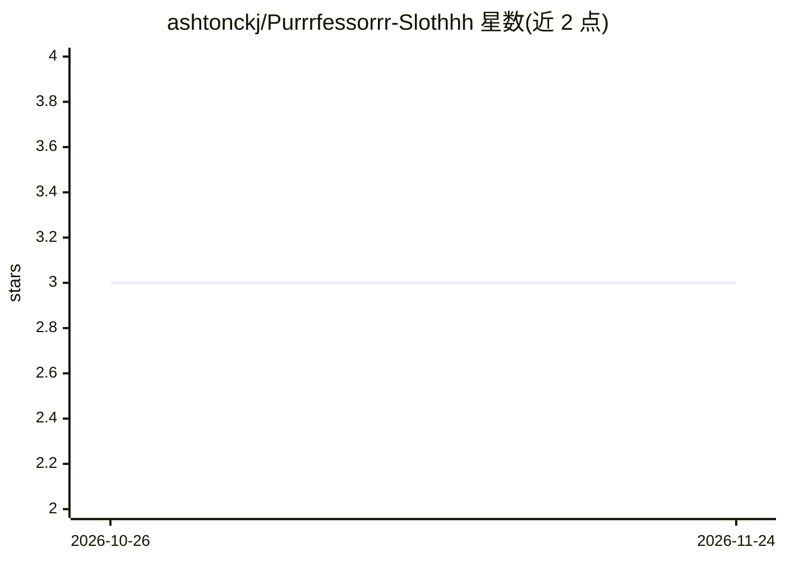

# ashtonckj/Purrrfessorrr-Slothhh

⭐ 3 · Python · MIT · 推送 2026-11-23 · [GitHub](https://github.com/ashtonckj/Purrrfessorrr-Slothhh) · [官网](https://dev.to/ashtonckj/we-built-a-pixel-art-office-where-five-cats-do-your-data-analysis-while-a-sloth-naps-2mld) · 组织维护

**像素风本地数据分析应用：上传数据集自动完成探查、清洗与可视化**

本地运行的探索性数据分析工具：上传 CSV/TSV/XLSX 后自动执行缺失值、重复、类型问题与 IQR 离群值检查，生成基于真实数据的图表与摘要，附带 Python/R 代码片段，可导出 ZIP 或 Jupyter notebook。统计全部来自确定性 Python 例程；可选接入 Ollama 运行的 Gemma 3 模型仅负责解释结果与开放问答，不参与计算且只读发现摘要，不接触原始数据行。需要 Python 3.10+，模型权重不随包分发。

## 筛选速览

| 维度 | 判定 | 备注 |
|---|---|---|
| AI 角色 | `ai-enhanced` | 去掉 AI 部分产品仍成立 |
| 许可风险 | `permissive` | MIT |
| 部署形态 | `library` | 以包/库形式分发 |
| 模型依赖 | local-ok | 支持本地模型 |
| 硬件要求 | — | 无带数字的原话,不猜 |
| 安装摩擦 | `low` | 无编译、无系统依赖或容器化 |
| 成熟度 | — | 结构信号不足 |

## 能力要点

- 缺失值/重复/类型/IQR 离群值等数据质量检查
- 每张分析卡附带可复用的 Python 与 R 代码片段
- 可选 Ollama+Gemma 3 仅做解释，统计由确定性例程生成
- 结果导出为 ZIP 或 Jupyter notebook

## 适用场景

- 快速完成一份新数据集的探索性分析
- 生成可复用的清洗与预处理代码片段
- 不把原始数据上传到云端的本地数据分析

## 场景标签

`数据分析` · 领域:效率与自动化

## 证据(README 行号)

> L19: **Purrrfessorrr Slothhh** turns that routine into a tiny office. Drop in a CSV, TSV, or XLSX, pick what matters, an
> L34: > **The numbers are never made up.** All statistics come from deterministic Python routines. The optional Gemma mod
> L92: Without a model, the app still runs the full analysis and answers common questions with built-in rules. To unlock o

## 星数曲线

2026-10-26 3 → 2026-11-24 3（+0）

---
*卡片 v1 · prompt 1.4 · 生成 2026-11-22 · 置信度 high · 依据 README sha `d0777d61f2b1` · [字段定义](../../DATASET.md)*
